# Dokumen Teknis Modul 4: Next.js App Router

**Nama/NIM:** Pradana Akbar Razan /105224005

**Repositori:** https://github.com/PradanaAkbarRazan/GudangKu

**Versi Next.js:** 16.4.2

**Cache Components:** Aktif (`cacheComponents: true`)

**Partial Prefetching:** Aktif (`partialPrefetching: true`)

---

## 1. Peta Rute

### 1.1 Konfigurasi Next.js

Versi Next.js diperiksa melalui perintah `npx next --version`. Hasilnya menunjukkan versi 16.4.2. Berkas `next.config.ts` menunjukkan bahwa Cache Components dan Partial Prefetching diaktifkan.

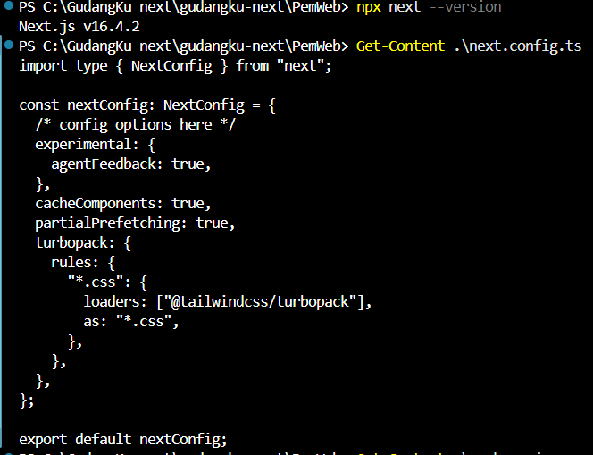

### 1.2 Tabel Rute

| URL | Berkas di `app/` | Jenis Rute | Isi Halaman |
|---|---|---|---|
| `/` | `app/page.tsx` | Statis | Halaman utama GudangKu. |
| `/barang` | `app/barang/page.tsx` | Statis | Menampilkan daftar barang dan fitur pencarian. |
| `/barang/[id]` | `app/barang/[id]/page.tsx` | Dinamis | Menampilkan detail barang berdasarkan ID dan memvalidasi parameter rute. |
| `/tentang` | `app/tentang/page.tsx` | Statis | Menampilkan informasi tentang aplikasi. |
| `/transaksi` | `app/transaksi/page.tsx` | Statis | Menampilkan halaman transaksi. |
| Rute barang tidak ditemukan | `app/barang/[id]/not-found.tsx` | Berkas khusus | Menampilkan pesan ketika ID barang tidak valid atau barang tidak tersedia. |
| URL tidak dikenal | `app/not-found.tsx` | Berkas khusus | Menampilkan halaman tidak ditemukan secara umum. |

### 1.3 Struktur Folder `app/`

Berikut struktur akhir setelah folder pengujian sementara `app/uji/` dihapus.

```text
app/
├── barang/
│   ├── [id]/
│   │   ├── not-found.tsx
│   │   └── page.tsx
│   ├── error.tsx
│   ├── layout.tsx
│   ├── loading.tsx
│   ├── page.tsx
│   └── template.tsx
├── transaksi/
│   └── page.tsx
├── tentang/
│   └── page.tsx
├── globals.css
├── layout.tsx
├── not-found.tsx
└── page.tsx
```

### 1.4 Hasil Build dan Peta Rute

Hasil `npm run build` final menunjukkan rute berikut:

```text
Route (app)
┌ ○ /
├ ○ /_not-found
├ ○ /barang
├   /barang/[id]
│ ├ ◐ /barang/[id]
│ ├ ○ /barang/1
│ ├ ○ /barang/2
│ └ ◐ [+4 more paths]
├ ○ /tentang
└ ○ /transaksi
```

Keterangan:

- `○` berarti rute diprerender sebagai konten statis.
- `◐` berarti Partial Prerender, yaitu HTML statis dengan bagian dinamis yang dikirim melalui streaming server.

Rute detail barang menggunakan `generateStaticParams()` untuk mendaftarkan ID barang yang tersedia saat build.

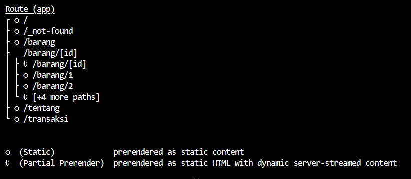

---

## 2. Layout, Template, dan Berkas Khusus

### 2.1 Pengujian Layout dan Template

Pengujian dilakukan pada halaman daftar barang dengan dua kolom catatan. Kolom pertama berada pada `app/barang/layout.tsx`, sedangkan kolom kedua berada pada `app/barang/template.tsx`.

Sebelum navigasi, kedua kolom diisi dengan teks `LAYOUT-TETAP` dan `TEMPLATE-RESET`.

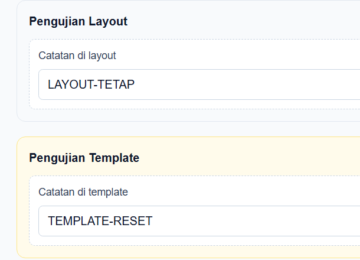

Ketika berpindah ke halaman detail barang, teks pada kolom layout tetap terlihat, sedangkan kolom template kembali kosong. Hal ini menunjukkan perbedaan perilaku layout dan template ketika segmen rute anak berubah.

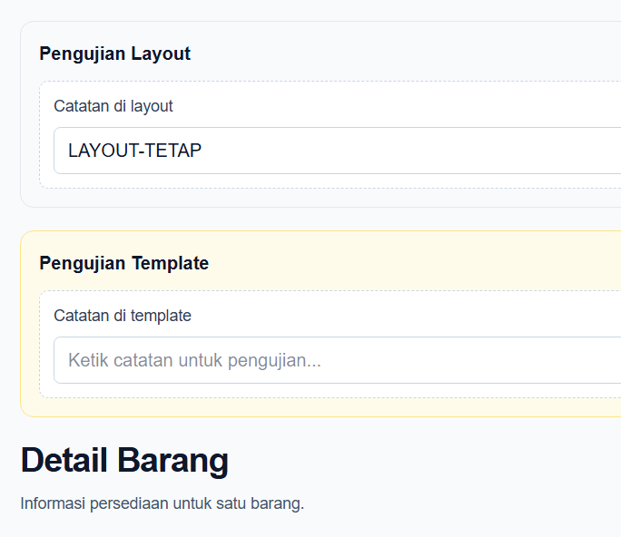

Saat kembali ke halaman daftar barang, kedua teks terlihat lagi. Hasil tersebut dicatat sebagai perilaku yang diamati saat navigasi kembali ke halaman sebelumnya.

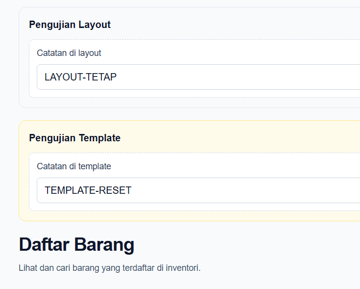

### 2.2 Pengujian `loading.tsx` dan `error.tsx`

Untuk menguji loading dan error, dibuat rute sementara `/uji/lambat` dan `/uji/galat`. Rute tersebut digunakan untuk melihat perilaku berkas khusus pada mode development dan production.

#### Mode Development

Pada `/uji/lambat`, halaman menampilkan pesan loading sebelum konten selesai dimuat. Pada `/uji/galat`, halaman menampilkan kotak error dan tombol untuk mencoba kembali.

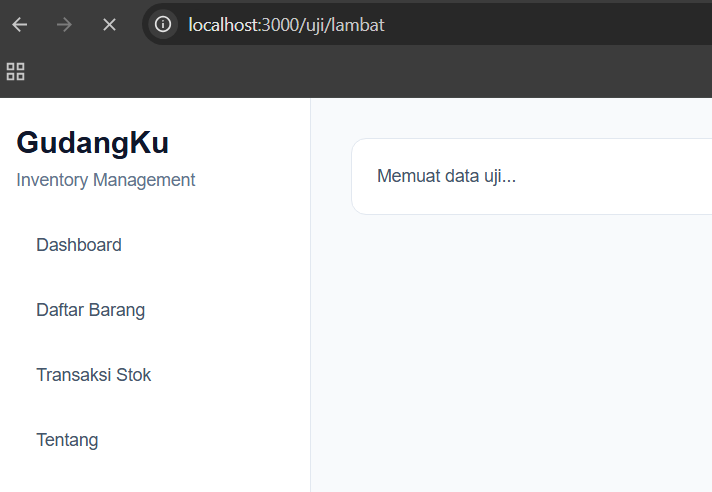

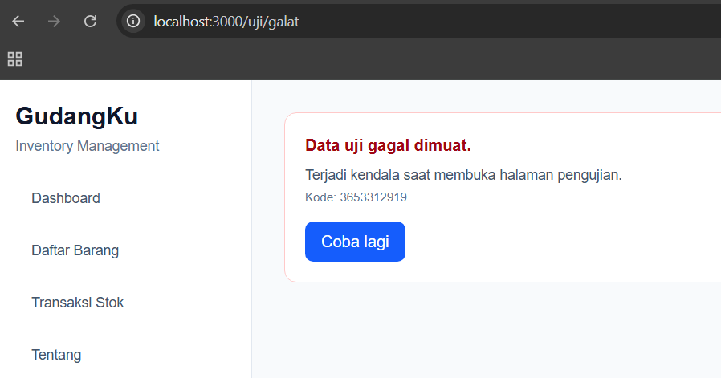

#### Mode Production

Pengujian juga dilakukan setelah proses build selesai dan server production dijalankan. Pesan loading dan kotak error berhasil diamati.

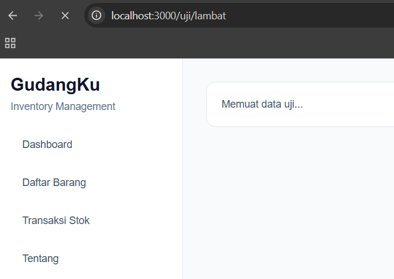

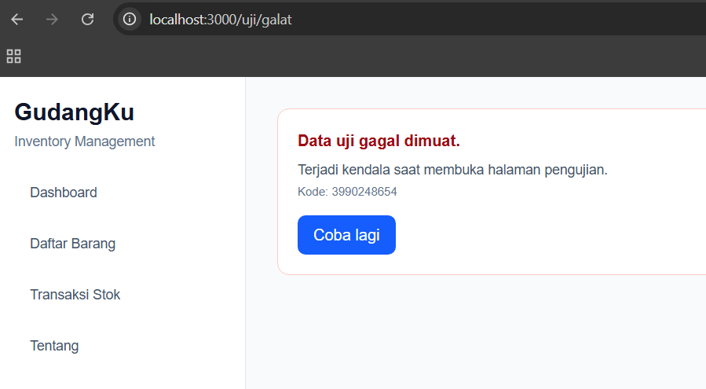

Setelah pengujian selesai, folder `app/uji/` dihapus. Build final kemudian dijalankan kembali dan berhasil tanpa rute pengujian tersebut.

---

## 3. Rute Dinamis dan Validasi `params`

### 3.1 Aturan Validasi

Rute detail barang didefinisikan dalam `app/barang/[id]/page.tsx`. Halaman menerima `params` bertipe `Promise<{ id: string }>` dan mengambil nilainya menggunakan `await params`.

Validasi format ID dilakukan menggunakan pola berikut:

```tsx
if (!/^[1-9]\d*$/.test(id)) notFound();
```

Pola tersebut menerima bilangan bulat positif tanpa angka nol di depan. Setelah validasi format, aplikasi mencari barang berdasarkan `routeId`. Jika barang tidak ditemukan, fungsi `notFound()` dipanggil sehingga halaman barang tidak ditemukan ditampilkan.

Fungsi `generateStaticParams()` juga digunakan untuk mendaftarkan parameter barang yang tersedia ketika build.

### 3.2 Tabel Pengujian URL

| URL | Hasil yang Diharapkan | Hasil Aktual | Status HTTP |
|---|---|---|---:|
| `/barang/1` | Detail barang ditampilkan jika ID tersedia | Detail barang berhasil diakses | 200 |
| `/barang/abc` | Barang tidak ditemukan karena format ID salah | Halaman Barang tidak ditemukan | 200 |
| `/barang/999` | Barang tidak ditemukan jika ID tidak tersedia | Halaman Barang tidak ditemukan | 200 |
| `/barang/01` | Barang tidak ditemukan karena nol di depan tidak diperbolehkan | Halaman Barang tidak ditemukan | 200 |
| `/tidak-ada` | Halaman tidak ditemukan secara umum | URL tidak ditemukan | 404 |

Status HTTP diperiksa menggunakan `curl.exe` di PowerShell. Perintah yang digunakan:

```powershell
curl.exe -s -o NUL -w "%{http_code}`n" http://localhost:3000/barang/1
curl.exe -s -o NUL -w "%{http_code}`n" http://localhost:3000/barang/abc
curl.exe -s -o NUL -w "%{http_code}`n" http://localhost:3000/barang/999
curl.exe -s -o NUL -w "%{http_code}`n" http://localhost:3000/barang/01
curl.exe -s -o NUL -w "%{http_code}`n" http://localhost:3000/tidak-ada
```

Hasil pengujian menunjukkan bahwa empat URL di bawah `/barang/...` mengembalikan status 200, sedangkan `/tidak-ada` mengembalikan status 404. Meskipun beberapa URL menampilkan halaman Barang tidak ditemukan, status HTTP yang diterima tetap 200 pada pengujian tersebut. Hasil dicatat sesuai keluaran aktual; tampilan halaman dan status HTTP merupakan dua hal yang berbeda.

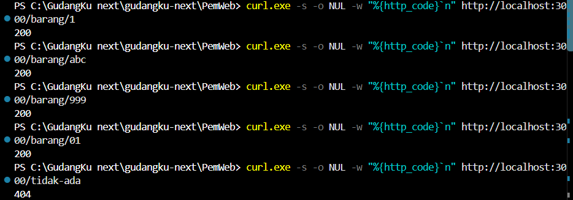

---

## 4. Pembagian Server dan Client Components

### 4.1 Tabel Pembagian Komponen

| Komponen/Berkas | Jenis | Alasan Teknis |
|---|---|---|
| `app/layout.tsx` | Server Component | Menyediakan layout utama aplikasi. |
| `app/page.tsx` | Server Component | Menyusun halaman utama tanpa deklarasi `use client`. |
| `app/barang/page.tsx` | Server Component | Menyediakan halaman daftar barang dan merender komponen inventori. |
| `app/barang/layout.tsx` | Server Component | Menyediakan pembungkus bersama pada segmen barang. |
| `app/barang/template.tsx` | Server Component | Menyediakan pembungkus yang dipasang ulang ketika segmen anak berubah. |
| `app/barang/[id]/page.tsx` | Server Component | Memproses `params`, memvalidasi ID, mencari barang, dan memanggil `notFound()`. |
| `app/barang/[id]/not-found.tsx` | Server Component | Menampilkan halaman ketika barang tidak ditemukan. |
| `app/not-found.tsx` | Server Component | Menampilkan halaman ketika URL tidak dikenal. |
| `app/barang/loading.tsx` | Server Component | Menyediakan UI loading selama konten dimuat. |
| `app/barang/error.tsx` | Client Component | Menangani error dan menyediakan tombol interaktif melalui `reset()`. |
| `components/InventoryClient.tsx` | Client Component | Menggunakan `useState`, `useMemo`, dan `onChange` untuk pencarian barang. |
| `components/KolomCatatan.tsx` | Client Component | Mengelola state input catatan dan perubahan nilainya. |
| `components/Sidebar.tsx` | Client Component | Dideklarasikan menggunakan `use client` untuk kebutuhan sisi klien. |
| `components/TransactionsClient.tsx` | Client Component | Dideklarasikan menggunakan `use client` untuk interaksi halaman transaksi. |

Komponen yang memerlukan state, event, atau interaksi pengguna ditempatkan di sisi klien. Sementara itu, halaman, layout, template, dan tampilan statis yang tidak memerlukan interaksi klien tetap menjadi Server Components.

### 4.2 Pengujian `server-only`

Berkas `lib/data.ts` ditandai sebagai modul khusus server:

```ts
import "server-only";

import { mockProducts } from "./mockData";

export const daftarBarang = mockProducts;
```

Pengujian dilakukan dengan mengimpor dan menggunakan `daftarBarang` sementara di dalam `components/InventoryClient.tsx`, yang merupakan Client Component. Next.js kemudian menampilkan error karena modul `server-only` tidak boleh diimpor ke Client Component.

Setelah bukti diambil, impor dan kode pengujian sementara dihapus kembali dari `InventoryClient.tsx`. Berkas `lib/data.ts` dipertahankan untuk penggunaan di sisi server.

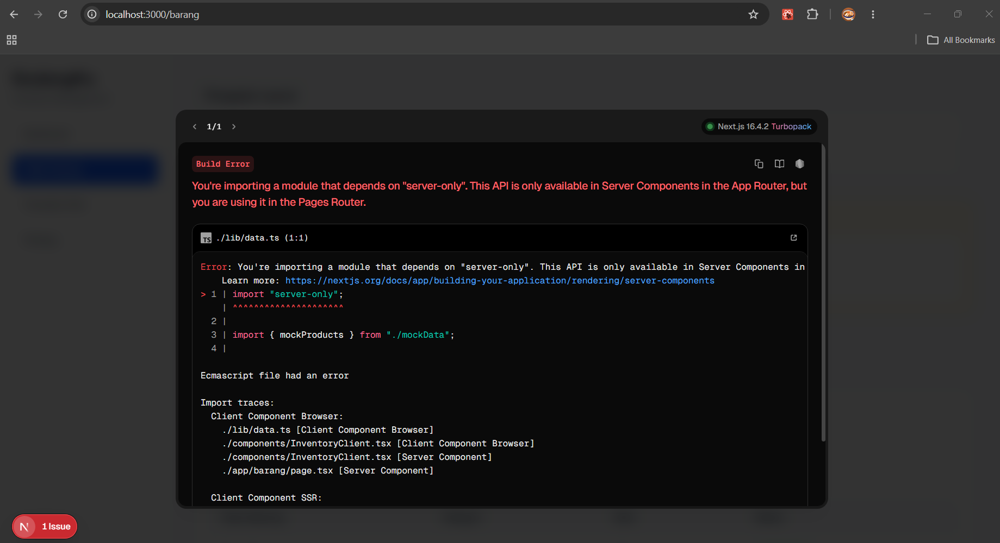

---

## 5. Verifikasi

Pemeriksaan akhir dilakukan setelah kode pengujian sementara dihapus dan folder `app/uji/` dihapus.

### 5.1 Pemeriksaan TypeScript

Perintah:

```powershell
npx tsc --noEmit
```

**Hasil:** berhasil tanpa pesan error TypeScript.

### 5.2 Pemeriksaan Lint

Perintah:

```powershell
npm run lint
```

**Hasil:** berhasil tanpa pesan error lint.

### 5.3 Build Production

Perintah:

```powershell
npm run build
```

**Hasil:** build final berhasil.

Proses kompilasi, pemeriksaan TypeScript, pengumpulan data halaman, pembuatan halaman statis, dan optimasi rute selesai tanpa error. Tabel rute final juga tidak lagi memuat `/uji/galat` dan `/uji/lambat`.

Pada percobaan awal setelah folder `app/uji/` dihapus, build mengalami error karena file tipe hasil generasi di `.next/dev/types/validator.ts` masih merujuk pada halaman pengujian yang telah dihapus. Masalah diselesaikan dengan menghapus folder hasil generasi `.next` dan menjalankan `npm run build` kembali.

Build final berhasil setelah langkah tersebut.

---

## 6. Kendala dan Penyelesaian

### 6.1 Hydration Mismatch

Pada mode development, sempat muncul peringatan hydration mismatch yang menyebut atribut HTML seperti `bis_skin_checked` dan `fdprocessedid`. Atribut tersebut kemungkinan ditambahkan oleh ekstensi browser. Peringatan ini dibedakan dari error `server-only` yang memang sengaja dipicu untuk pengujian.

### 6.2 Referensi Tipe dari Folder Pengujian

Setelah folder `app/uji/` dihapus, build sempat gagal karena file tipe hasil generasi masih merujuk pada halaman pengujian. Folder `.next` dihapus agar Next.js menghasilkan ulang file terkait. Setelah build dijalankan kembali, proses berhasil.

### 6.3 Perbedaan Tampilan dan Status HTTP

Beberapa URL barang yang tidak valid menampilkan halaman Barang tidak ditemukan, tetapi hasil `curl.exe` menunjukkan status 200. Hasil dicatat sesuai keluaran aktual karena status respons HTTP dapat dipengaruhi oleh streaming. URL tidak dikenal `/tidak-ada` mengembalikan status 404.

---

## 7. Catatan Pemanfaatan AI

ChatGPT digunakan sebagai bantuan untuk memahami Next.js App Router, menyiapkan langkah pengujian, menelusuri error, serta menyusun dokumentasi teknis.

Pengujian tetap dilakukan pada proyek melalui pemeriksaan kode, akses URL di browser, `curl.exe`, serta perintah `npx tsc --noEmit`, `npm run lint`, dan `npm run build`. Isi dokumen disusun berdasarkan konfigurasi, kode, screenshot, dan keluaran terminal yang diamati selama pengerjaan.
