# Dokumen Teknis Modul 5 — Formulir, Validasi, Session, dan Cookie

**Nama/NIM:** Pradana Akbar Razan /105224005
**Repositori:** https://github.com/PradanaAkbarRazan/GudangKu
**Branch:** `main`
**Lingkungan uji:** Next.js 16, React 19, Zod 4, Windows, Chrome Incognito (`localhost:3000`)

> **Catatan sebelum dikumpulkan:** simpan tangkapan layar aktual ke folder `docs/praktikum/modul-05/` dengan nama yang dirujuk di bagian 3 dan 4. Pastikan tidak ada nilai cookie session atau kredensial yang tampak pada tangkapan layar. Isi identitas di atas sebelum commit.

## 1. Skema Validasi

Skema Zod 4 berada di `lib/skema.ts` dan digunakan oleh Server Action sebelum data barang disimpan. Semua nilai `FormData` dibaca sebagai string, lalu Zod memeriksa dan mengubah nilai stok menjadi angka.

| Kolom formulir | Tipe / aturan Zod | Pesan galat |
|---|---|---|
| `name` (Nama Barang) | String, di-trim, wajib, 3–80 karakter | `Nama barang minimal 3 karakter.` atau `Nama barang maksimal 80 karakter.` |
| `category` (Kategori) | Pilihan enum: `Sembako`, `Makanan`, `Minuman`, `Bahan Kue` | `Pilih kategori barang yang valid.` |
| `stock` (Stok) | String angka bulat, wajib, 0–100.000; kemudian diubah menjadi `number` | `Stok wajib diisi.`, `Stok harus berupa bilangan bulat.`, `Stok tidak boleh negatif.`, atau `Stok maksimal 100.000.` |
| `minimumStock` (Stok Minimum) | String angka bulat, wajib, 0–100.000; kemudian diubah menjadi `number` | Pesan yang sesuai, misalnya `Stok minimum maksimal 100.000.` |
| `unit` (Satuan) | Pilihan enum: `kg`, `liter`, `pcs`, `botol` | `Pilih satuan barang yang valid.` |
| `tersedia` (Barang tersedia) | Checkbox, dikonversi menjadi boolean dengan `z.stringbool().default(false)` | Nilai tidak sesuai tipe akan ditolak oleh skema. Checkbox yang tidak dicentang tidak mengirim field sehingga nilai default-nya `false`. |

Pilihan kategori dan satuan pada formulir harus sama dengan nilai yang diperbolehkan oleh `z.enum` pada `lib/skema.ts`.

### Validasi semantik

Nama barang tidak boleh sama dengan nama barang lain yang sudah terdaftar. Pemeriksaan ini dilakukan dengan `namaBarangSudahAda()` di `lib/data.ts`, setelah `skemaBarang.safeParse()` berhasil dan sebelum `tambahBarang()` dipanggil. Skema Zod saja tidak dapat mengetahui seluruh isi inventori yang sedang tersimpan; oleh sebab itu, pemeriksaan duplikasi dilakukan di Server Action.

## 2. Alur Server Action

Alur penyimpanan barang pada `app/barang/actions.ts` adalah sebagai berikut:

1. **Pemeriksaan session:** `bacaSesi()` harus mengembalikan session yang valid. Jika tidak, aksi mengembalikan pesan `Silakan masuk terlebih dahulu.`.
2. **Validasi bentuk:** `skemaBarang.safeParse()` memeriksa kolom formulir. Jika gagal, `z.flattenError(...).fieldErrors` dikembalikan agar galat ditampilkan pada kolom masing-masing.
3. **Validasi semantik:** `namaBarangSudahAda()` memeriksa apakah nama sudah digunakan. Jika duplikat, penyimpanan dihentikan dan galat dikembalikan pada kolom nama.
4. **Mutasi data:** `tambahBarang()` menambahkan barang baru ke array `daftarBarang` di `lib/data.ts`.
5. **Perbarui dan alihkan:** `revalidatePath("/barang")` meminta halaman daftar barang dirender ulang, lalu `redirect()` mengarahkan pengguna ke halaman detail barang yang baru ditambahkan. `redirect()` diletakkan di luar blok `try`.

### Pembagian berkas

| Berkas | Peran |
|---|---|
| `app/barang/tambah/page.tsx` | Server Component; membaca session dan mengalihkan pengguna yang tidak memiliki session valid ke `/masuk`. |
| `app/barang/page.tsx` dan `app/barang/[id]/page.tsx` | Server Component untuk daftar dan detail barang; menggunakan sumber data `daftarBarang`. |
| `app/masuk/page.tsx` | Server Component yang menampilkan halaman login. |
| `components/FormBarang.tsx` | Client Component; formulir tambah barang menggunakan `useActionState`, menampilkan galat per kolom dan status pending. |
| `components/FormMasuk.tsx` | Client Component; formulir login menggunakan `useActionState`. |
| `components/InventoryClient.tsx` | Client Component untuk pencarian serta tombol tambah barang. |
| `app/barang/actions.ts` | Server Action `simpanBarang`; pemeriksaan session, validasi, pemeriksaan duplikasi, penyimpanan, `revalidatePath`, dan `redirect`. |
| `app/masuk/actions.ts` | Server Action untuk login dan logout. |
| `lib/skema.ts` | Skema Zod 4 untuk data barang dan kredensial login. |
| `lib/status-form.ts` | Tipe status untuk galat per kolom, pesan umum, dan nilai formulir. |
| `lib/data.ts` | Data tiruan serta fungsi pengecekan duplikasi dan penambahan barang; dilindungi dengan `server-only`. |
| `lib/sesi.ts` | Pembuatan, pembacaan, dan penghapusan session pada sisi server. |
| `proxy.ts` | Pemeriksaan awal keberadaan cookie `sesi` untuk rute `/barang/tambah`. |

Validasi di browser seperti `required`, `min`, `max`, dan `step` membantu pengguna, tetapi tidak dipercaya sebagai perlindungan data. Server Action menerima permintaan POST, sehingga tetap memeriksa session dan memvalidasi ulang data di server.

## 3. Bukti Uji Validasi

Tabel berikut berisi hasil yang sudah dicoba pada aplikasi. Pengujian barang valid dan nama duplikat dilakukan melalui formulir. Pengujian nilai tidak valid dilakukan dengan atribut `novalidate` ditambahkan pada elemen `<form>` tambah barang lewat DevTools, sehingga pesan yang muncul berasal dari validasi server.

| No. | Masukan / skenario | Hasil yang diharapkan | Hasil nyata |
|---:|---|---|---|
| 1 | Nama `Uji Barang Modul 5`, kategori Minuman, stok 12, minimum 3, satuan botol | Barang tersimpan, kode dibuat, halaman detail terbuka, dan barang muncul di daftar | **Lulus.** Halaman detail `/barang/7` menampilkan kode `PRD007`; daftar menampilkan 7 barang. |
| 2 | Nama `Beras Premium` yang sudah ada, dengan field lainnya valid | Nama duplikat ditolak dan barang tidak ditambahkan | **Lulus.** Galat `Nama barang sudah terdaftar.` tampil di bawah kolom nama. |
| 3 | Nama `AB`, field lain valid (`novalidate`) | Nama terlalu pendek ditolak oleh server | **Lulus.** Galat `Nama barang minimal 3 karakter.` tampil. |
| 4 | Stok `-1`, nama baru dan field lain valid (`novalidate`) | Stok negatif ditolak oleh server | **Lulus.** Galat `Stok tidak boleh negatif.` tampil. |
| 5 | Stok `2.5`, nama baru dan field lain valid (`novalidate`) | Stok desimal ditolak oleh server | **Lulus.** Galat `Stok harus berupa bilangan bulat.` tampil. |
| 6 | Stok `100001`, nama baru dan field lain valid (`novalidate`) | Nilai di atas batas ditolak oleh server | **Lulus.** Galat `Stok maksimal 100.000.` tampil. |
| 7 | Stok kosong, nama baru dan field lain valid (`novalidate`) | Field stok wajib ditolak oleh server | **Lulus.** Galat `Stok wajib diisi.` tampil. |
| 8 | Stok minimum `100001`, nama baru dan field lain valid (`novalidate`) | Nilai stok minimum di atas batas ditolak | **Lulus.** Galat `Stok minimum maksimal 100.000.` tampil. |

### Lokasi tangkapan layar validasi

Simpan screenshot hasil pengujian aktual di `docs/praktikum/modul-05/` dengan nama berikut:

- `01-barang-valid.png` — halaman detail barang setelah penambahan berhasil.
- `02-nama-duplikat.png` — galat nama barang duplikat.
- `03-nama-terlalu-pendek.png` — galat nama `AB` dengan `novalidate`.
- `04-stok-negatif.png` — galat stok `-1` dengan `novalidate`.
- `05-stok-desimal.png` — galat stok `2.5` dengan `novalidate`.
- `06-stok-maksimum.png` — galat stok `100001` dengan `novalidate`.
- `07-stok-kosong.png` — galat stok kosong dengan `novalidate`.
- `08-stok-minimum-maksimum.png` — galat stok minimum `100001` dengan `novalidate`.

Jika file screenshot sudah disimpan dengan nama tersebut, gunakan tautan berikut untuk menampilkannya di GitHub:

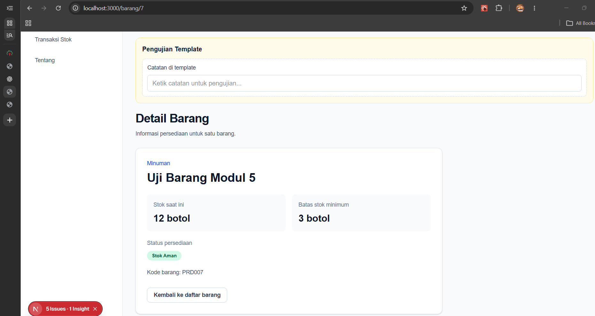

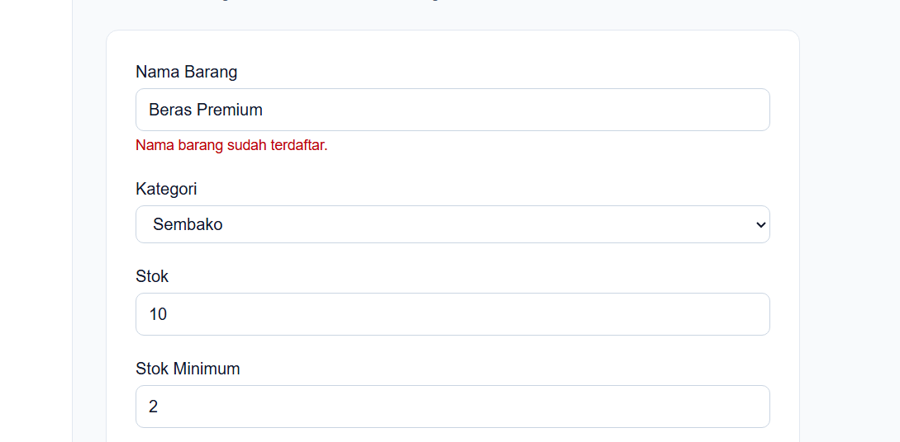

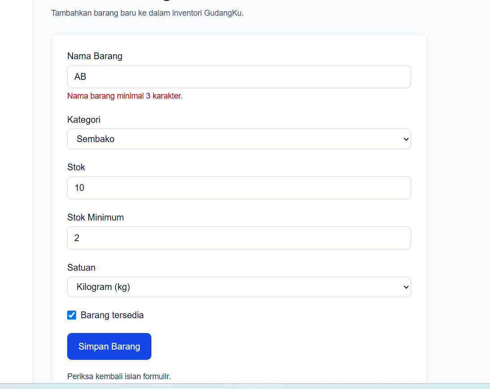

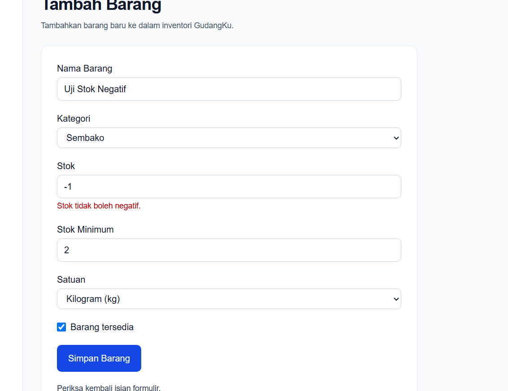

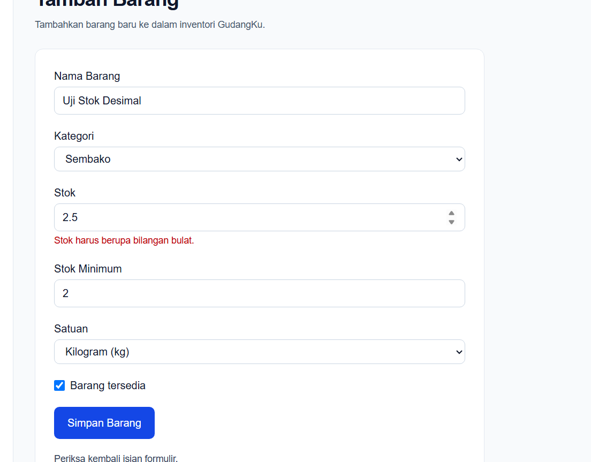

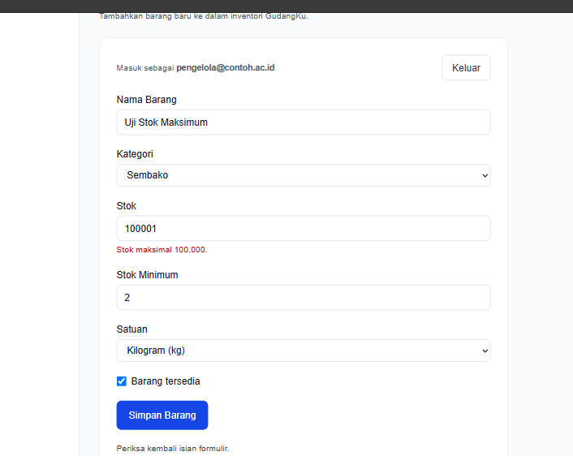

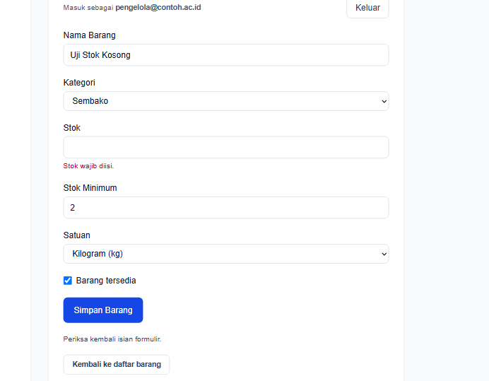

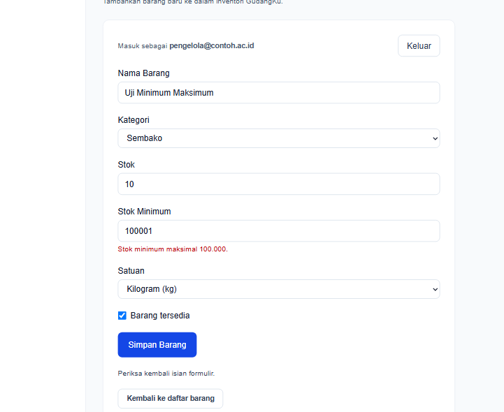

## 4. Session dan Cookie

### Implementasi session

Kredensial demo disimpan pada `.env.local`, sedangkan `.env.example` hanya berisi nama variabel tanpa nilai rahasia. Login memvalidasi format input melalui `skemaMasuk`, mencocokkan email dan kata sandi dengan variabel lingkungan, lalu memanggil `buatSesi(email)` setelah cocok.

`lib/sesi.ts` membuat ID acak dengan `crypto.randomUUID()` dan menyimpan data sesi di `Map` server, berupa email dan waktu kedaluwarsa. Cookie browser hanya memuat ID sesi, bukan informasi akun. Logout memanggil `hapusSesi()`, menghapus ID dari `Map`, dan menghapus cookie. Penyimpanan `Map` hanya untuk praktikum: data sesi hilang saat proses server dimulai ulang dan belum cocok untuk penerapan produksi multi-instance.

### Atribut cookie

| Atribut | Konfigurasi | Fungsi keamanan |
|---|---|---|
| `HttpOnly` | `true` | Mencegah JavaScript membaca cookie melalui `document.cookie`; mengurangi risiko pencurian cookie melalui XSS. |
| `Secure` | `true` di produksi; `false` untuk HTTP localhost dalam development | Membatasi pengiriman cookie ke HTTPS di produksi dan mengurangi risiko penyadapan lewat HTTP. |
| `SameSite` | `"lax"` | Mengurangi risiko CSRF dengan membatasi pengiriman cookie pada sebagian besar permintaan lintas situs. |
| `Path` | `"/"` | Membuat cookie berlaku untuk seluruh rute aplikasi. |
| `Max-Age` | `28800` detik (8 jam) | Membatasi masa berlaku cookie sehingga jendela penyalahgunaan cookie yang dicuri berkurang. |

### Hasil uji session

| No. | Pengujian | Hasil nyata |
|---:|---|---|
| 1 | Login menggunakan akun demo | **Lulus.** Login berhasil dan diarahkan ke `/barang/tambah`; email akun tampil. |
| 2 | Periksa cookie di Application | **Lulus.** Cookie bernama `sesi` terlihat dengan `HttpOnly`, `SameSite=Lax`, dan `Path=/`; `Secure` tidak aktif pada HTTP localhost sesuai konfigurasi development. |
| 3 | Jalankan `document.cookie` | **Lulus.** Hasil tidak menampilkan cookie `sesi`, sesuai atribut `HttpOnly`. |
| 4 | Logout | **Lulus.** Browser diarahkan setelah logout dan cookie `sesi` terhapus. |
| 5 | Akses `/barang/tambah` tanpa login | **Lulus.** Pengguna diarahkan ke `/masuk`. |
| 6 | Pasang cookie palsu bernama `sesi` | **Lulus.** Pengguna tetap diarahkan ke `/masuk`; cookie tidak valid tidak memperoleh sesi server. |
| 7 | Pasang kembali cookie lama setelah logout | **Lulus.** Pengguna tetap diarahkan ke `/masuk karena ID sesi sudah dihapus dari penyimpanan server. Cookie uji lalu dihapus kembali. |

Simpan screenshot aktual session ke `docs/praktikum/modul-05/`:

- `09-cookie-application.png` — tabel Application/Cookies dengan `sesi`, `HttpOnly`, `SameSite`, `Path`; samarkan kolom Value.
- `10-document-cookie.png` — Console menunjukkan `document.cookie` tidak memuat `sesi`.
- `11-logout-cookie.png` — kondisi setelah logout ketika cookie `sesi` sudah terhapus.
- `12-cookie-palsu.png` — hasil penolakan cookie palsu.
- `13-cookie-lama.png` — hasil penolakan cookie lama setelah logout.

Setelah file bukti tersimpan, tautkan screenshot seperti berikut:

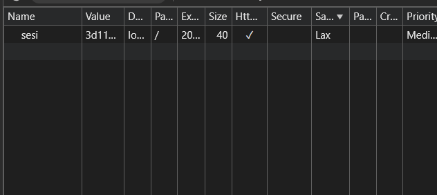

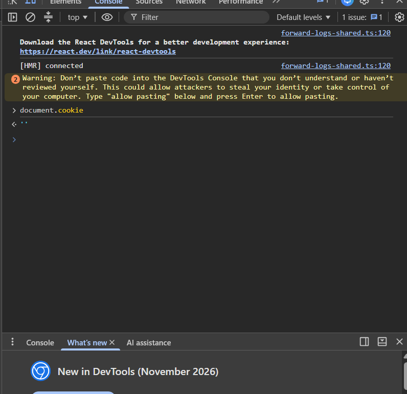

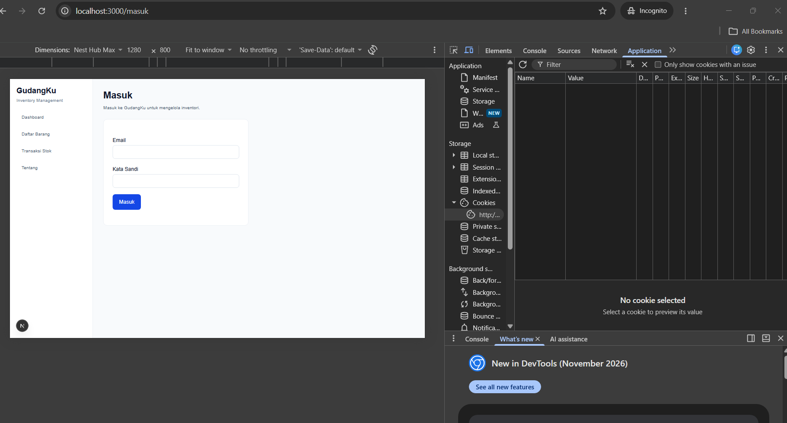

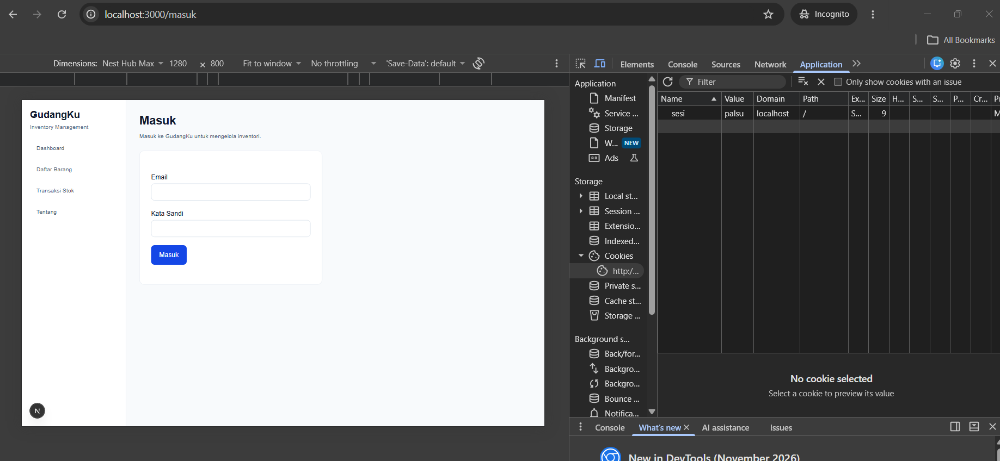

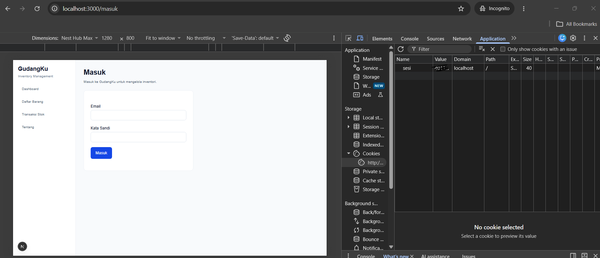

## 5. Keputusan Teknis

### Session disimpan di server

Implementasi memakai session di server: cookie browser berisi ID acak, sedangkan informasi email dan masa berlaku disimpan di `Map` server. Keuntungannya adalah session dapat dicabut saat logout dengan menghapus ID dari `Map`. Bila hanya memakai token bertanda tangan di cookie, token yang sudah diterbitkan biasanya masih berlaku sampai kedaluwarsa kecuali ada mekanisme pencabutan tambahan.

Penyimpanan `Map` digunakan sebagai simulasi praktikum, bukan penyimpanan produksi. Session dapat hilang saat proses server dimulai ulang dan tidak dibagikan antar-instance server.

### Batas peran `proxy.ts`

`proxy.ts` hanya memeriksa apakah cookie bernama `sesi` ada. Ini merupakan pemeriksaan awal agar pengguna tanpa cookie diarahkan ke `/masuk`. Keberadaan cookie tidak membuktikan bahwa session valid. Karena itu, `bacaSesi()` tetap dipanggil pada halaman tambah barang dan pada Server Action untuk memeriksa ID sesi di penyimpanan server. Pemeriksaan di Server Action sangat penting karena aksi dapat dipanggil melalui permintaan POST tanpa harus membuka halaman formulir terlebih dahulu.

## 6. Kendala dan Penyelesaian

1. **TypeScript tidak menemukan `lib/status-form.ts`.** File tersebut dibuat dengan tipe `StatusForm` berisi `galat`, `pesan`, dan `nilai`; setelah itu `npx tsc --noEmit` lolos.
2. **`InventoryClient` membutuhkan prop `products`.** Komponen diubah agar menerima daftar barang dari halaman server dan memakai `daftarBarang` dari `lib/data.ts`, lalu halaman utama juga diperbarui untuk mengirim prop yang sama.
3. **PowerShell tidak membaca rute `[id]` dengan cara biasa.** File dibaca menggunakan `Get-Content -LiteralPath ".\app\barang\[id]\page.tsx"` agar tanda kurung siku diperlakukan sebagai karakter literal.
4. **Validasi browser mencegah pengiriman input tidak sah.** Atribut `novalidate` ditambahkan sementara melalui DevTools pada form tambah barang yang benar. Pesan galat Zod kemudian muncul untuk nama pendek, stok negatif, stok desimal, stok melampaui batas, stok kosong, dan stok minimum melampaui batas.
5. **Peringatan prerender pada `Date.now()` ketika membaca session.** Halaman tambah barang menggunakan `connection()` dan `Suspense` agar pemeriksaan session dan waktu dilakukan pada request. Setelah halaman dimuat ulang, error merah tersebut tidak muncul lagi; peringatan development tentang cache disabled masih dapat tampil karena rendering dinamis.
6. **Peringatan hydration saat browser memakai ekstensi.** Error menunjuk ke kode `chrome-extension://...` dan atribut seperti `bis_skin_checked`; setelah ekstensi terkait dihapus dan halaman diperiksa dalam Incognito, overlay error hydration tidak terlihat lagi.
7. **Data inventori masih berupa array dalam memori.** Barang yang ditambahkan muncul di daftar dan halaman detail pada proses server yang sama, tetapi data akan kembali ke nilai awal saat server dimulai ulang. Persistensi database merupakan pekerjaan modul berikutnya.

Pemeriksaan akhir yang dijalankan setelah implementasi: `npx tsc --noEmit`, `npm run lint`, dan `git diff --check`; ketiganya selesai tanpa error.

## 7. Catatan Pemanfaatan AI

- **Alat:** ChatGPT digunakan sebagai asisten untuk memahami instruksi Modul 5, menyusun dan meninjau kode Zod 4, Server Action, formulir `useActionState`, session/cookie, `proxy.ts`, serta membantu menelusuri error TypeScript dan runtime.
- **Perintah verifikasi utama:** `npm ls zod`, `npm ls server-only`, `npx tsc --noEmit`, `npm run lint`, `git diff --check`, `git status --short`, dan pengujian langsung melalui browser/DevTools.
- **Bagian yang dibantu AI:** rancangan validasi, pemisahan Server Component dan Client Component, pemrosesan FormData, pemeriksaan nama duplikat, session server, atribut cookie, serta rencana pengujian.
- **Cara verifikasi:** kode disalin dan dijalankan secara manual di proyek GudangKu; hasil TypeScript dan lint diperiksa di terminal; hasil validasi formulir dan session diperiksa lewat browser; cookie diperiksa di Application dan `document.cookie`; pengujian input tidak valid dijalankan dengan `novalidate`; cookie palsu dan cookie lama diuji setelah logout.
- **Batasan:** autentikasi masih berupa akun demo, data inventori dan session masih berada di memori, serta tes ini bukan penilaian keamanan produksi. Hasil dan screenshot dalam dokumen merujuk pada pengujian lokal yang dilakukan selama praktikum.
