# Dokumen Teknis Modul 6 — PostgreSQL dan Prisma ORM

**Nama/NIM** : Pradana Akbar Razan / 105224005
**Repositori** : (https://github.com/PradanaAkbarRazan/GudangKu)

---

## 1. Rancangan Data

GudangKu menggunakan PostgreSQL sebagai sistem manajemen basis data relasional. Rancangan data Modul 6 terdiri dari dua entitas, yaitu **Produk** dan **RiwayatStok**, dengan relasi satu-ke-banyak (1:N).

Satu produk dapat memiliki banyak riwayat pergerakan stok, sedangkan setiap riwayat stok hanya terhubung dengan satu produk. Relasi tersebut memungkinkan aktivitas barang masuk dan keluar ditelusuri berdasarkan produk yang terkait.

### 1.1 Diagram ERD

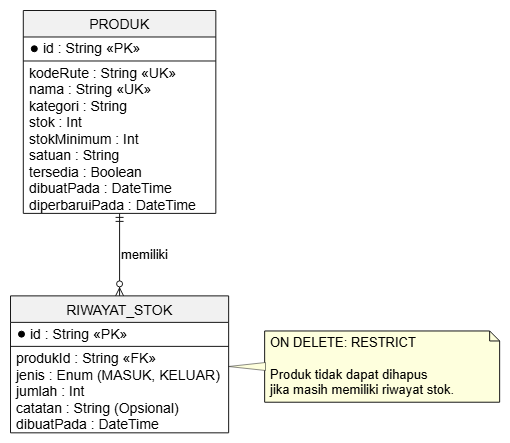

### 1.2 Entitas dan Atribut

**Entitas Produk**

| Atribut | Tipe Prisma | Keterangan |
|---|---|---|
| `id` | String | Primary Key, dibuat dengan `cuid()` |
| `kodeRute` | String | Kode produk, Unique |
| `nama` | String | Nama produk, Unique |
| `kategori` | String | Kategori produk |
| `stok` | Int | Jumlah stok, nilai awal `0` |
| `stokMinimum` | Int | Batas minimum stok, nilai awal `0` |
| `satuan` | String | Satuan produk |
| `tersedia` | Boolean | Status ketersediaan, nilai awal `true` |
| `dibuatPada` | DateTime | Waktu pembuatan data |
| `diperbaruiPada` | DateTime | Waktu terakhir data diperbarui |

**Entitas RiwayatStok**

| Atribut | Tipe Prisma | Keterangan |
|---|---|---|
| `id` | String | Primary Key, dibuat dengan `cuid()` |
| `produkId` | String | Foreign Key yang mengacu pada `Produk.id` |
| `jenis` | Enum `JenisPergerakan` | Jenis pergerakan: `MASUK` atau `KELUAR` |
| `jumlah` | Int | Jumlah stok yang bergerak |
| `catatan` | String? | Catatan tambahan, bersifat opsional |
| `dibuatPada` | DateTime | Waktu pencatatan riwayat |

### 1.3 Kunci dan Constraint

Rancangan basis data menggunakan kunci dan constraint berikut:

- **Primary Key (PK):** kolom `id` pada Produk dan RiwayatStok menjadi identitas unik setiap record.
- **Foreign Key (FK):** kolom `RiwayatStok.produkId` mengacu pada `Produk.id`.
- **Unique Constraint:** kolom `Produk.kodeRute` dan `Produk.nama` tidak boleh memiliki nilai duplikat.
- **Enum:** `JenisPergerakan` membatasi jenis transaksi menjadi `MASUK` dan `KELUAR`.

### 1.4 Relasi dan Aturan Penghapusan

Relasi Produk dan RiwayatStok menggunakan aturan `onDelete: Restrict`, yang diterapkan pada foreign key `RiwayatStok.produkId`.

Aturan ini dipilih karena riwayat pergerakan stok merupakan catatan aktivitas inventori yang perlu dipertahankan. Produk yang masih memiliki riwayat stok tidak boleh dihapus secara langsung karena penghapusan tersebut dapat memutus keterkaitan data historis.

Jika produk sudah tidak digunakan, status `tersedia` dapat diubah menjadi `false`. Produk dapat dinonaktifkan tanpa menghilangkan riwayat pergerakan stoknya.

---

## 2. Skema dan Migrasi

### 2.1 Skema Prisma

Skema basis data GudangKu didefinisikan menggunakan Prisma Schema dengan provider PostgreSQL. Skema terdiri dari dua model, yaitu `Produk` dan `RiwayatStok`, serta enum `JenisPergerakan`.

File skema berada di `PemWeb/prisma/schema.prisma`.

```prisma
generator client {
  provider = "prisma-client"
  output   = "../generated/prisma"
}

datasource db {
  provider = "postgresql"
}

enum JenisPergerakan {
  MASUK
  KELUAR
}

model Produk {
  id             String         @id @default(cuid())
  kodeRute       String         @unique
  nama           String         @unique
  kategori       String
  stok           Int            @default(0)
  stokMinimum    Int            @default(0)
  satuan         String
  tersedia       Boolean        @default(true)
  dibuatPada     DateTime       @default(now())
  diperbaruiPada DateTime       @updatedAt

  riwayatStok    RiwayatStok[]
}

model RiwayatStok {
  id         String           @id @default(cuid())
  produkId   String
  jenis      JenisPergerakan
  jumlah     Int
  catatan    String?
  dibuatPada DateTime         @default(now())

  produk     Produk           @relation(fields: [produkId], references: [id], onDelete: Restrict)
}
```

Keterangan elemen skema:

- `@id` menentukan primary key.
- `@default(cuid())` menghasilkan identitas unik untuk setiap record.
- `@unique` mencegah kode rute dan nama produk yang sama.
- `@relation` menghubungkan RiwayatStok dengan Produk melalui foreign key.
- `onDelete: Restrict` mencegah produk dihapus ketika masih memiliki riwayat stok.
- `String?` membuat kolom catatan bersifat opsional.
- `@updatedAt` memperbarui waktu perubahan record secara otomatis.

### 2.2 Konfigurasi Prisma

Konfigurasi Prisma 7 berada di `PemWeb/prisma.config.ts`. File ini mengatur lokasi skema, folder migrasi, perintah seed, dan URL koneksi database dari environment variable `DATABASE_URL`.

```ts
import "dotenv/config";
import { defineConfig } from "prisma/config";

export default defineConfig({
  schema: "prisma/schema.prisma",
  migrations: {
    path: "prisma/migrations",
    seed: "tsx prisma/seed.ts",
  },
  datasource: {
    url: process.env["DATABASE_URL"],
  },
});
```

### 2.3 Proses Migrasi

Migrasi awal dibuat menggunakan perintah berikut dari direktori `PemWeb`:

```powershell
npx prisma migrate dev --name init
```

Nama folder migrasi yang dihasilkan adalah `20261030094922_init`.

Struktur folder migrasi:

```text
PemWeb/
└── prisma/
    └── migrations/
        ├── 20261030094922_init/
        │   └── migration.sql
        └── migration_lock.toml
```

File `migration.sql` dihasilkan oleh Prisma berdasarkan `schema.prisma`. Migrasi membuat enum, tabel, primary key, indeks unik, dan foreign key.

### 2.4 Potongan Migration SQL

Berikut potongan penting dari `prisma/migrations/20261030094922_init/migration.sql`:

```sql
-- CreateEnum
CREATE TYPE "JenisPergerakan" AS ENUM ('MASUK', 'KELUAR');

-- CreateIndex
CREATE UNIQUE INDEX "Produk_kodeRute_key"
ON "Produk"("kodeRute");

CREATE UNIQUE INDEX "Produk_nama_key"
ON "Produk"("nama");

-- AddForeignKey
ALTER TABLE "RiwayatStok"
ADD CONSTRAINT "RiwayatStok_produkId_fkey"
FOREIGN KEY ("produkId")
REFERENCES "Produk"("id")
ON DELETE RESTRICT
ON UPDATE CASCADE;
```

### 2.5 Verifikasi Database PostgreSQL

Struktur tabel diperiksa langsung menggunakan `psql` dengan perintah:

```sql
\d "Produk"
\d "RiwayatStok"
```

Hasil pemeriksaan menunjukkan primary key, indeks unik, dan foreign key sesuai rancangan. Pada tabel RiwayatStok, constraint foreign key menerapkan aturan `ON DELETE RESTRICT`.

**Bukti pemeriksaan tabel Produk:**

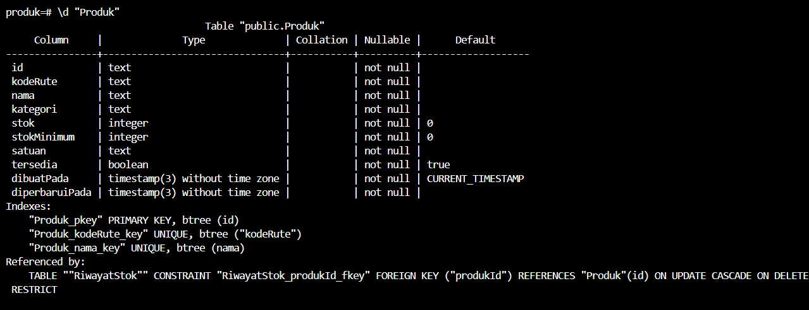

**Bukti pemeriksaan tabel RiwayatStok:**

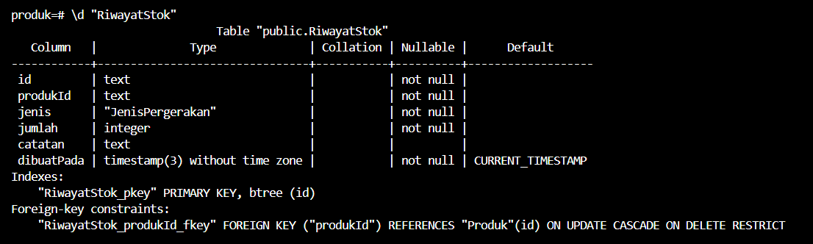

Status migrasi juga diperiksa menggunakan:

```powershell
npx prisma migrate status
```

Pemeriksaan akhir menunjukkan satu migrasi terdeteksi dan database berada dalam kondisi *up to date*.

---

## 3. Seed dan Prisma Client

### 3.1 Proses Seed

Seed digunakan untuk memasukkan data awal ke database PostgreSQL. Seed GudangKu berisi tiga data Produk dan empat data RiwayatStok.

Seed dijalankan menggunakan perintah:

```powershell
npx prisma db seed
```

Perintah dijalankan sebanyak dua kali untuk memastikan proses seed dapat diulang tanpa menghasilkan data duplikat. Keluaran kedua eksekusi menunjukkan:

```text
Seed selesai: 3 produk, 4 riwayat stok
```

Seed menggunakan `upsert`. Pada model Produk, `kodeRute` digunakan sebagai identitas unik. Pada RiwayatStok, `id` digunakan sebagai identitas unik. Dengan demikian, record yang identitas uniknya sudah ada tidak dibuat kembali sebagai duplikat ketika seed dijalankan ulang.

**Bukti seed dijalankan dua kali:**

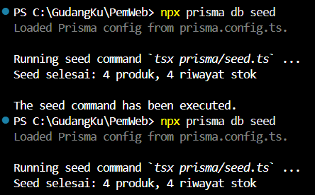

Selain data dasar dari seed, produk **Kopi GudangKu** ditambahkan melalui formulir aplikasi untuk pengujian operasi Create Produk. Produk tersebut juga digunakan sebagai data uji CRUD RiwayatStok.

### 3.2 Verifikasi Prisma Studio

Data hasil seed dan operasi Create diperiksa melalui Prisma Studio. Pemeriksaan dilakukan pada tabel Produk dan RiwayatStok.

**Tabel Produk:**

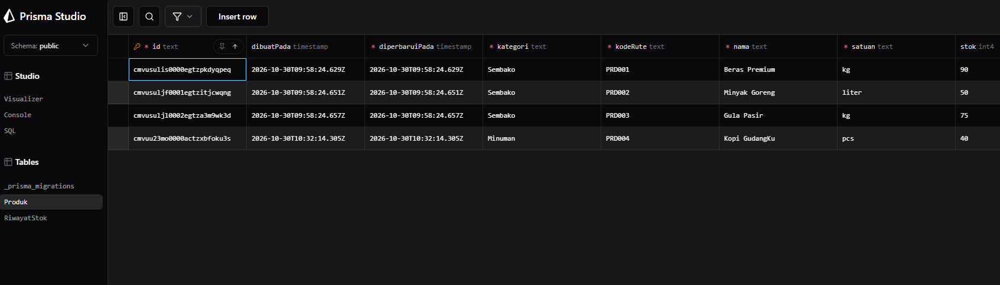

**Tabel RiwayatStok:**

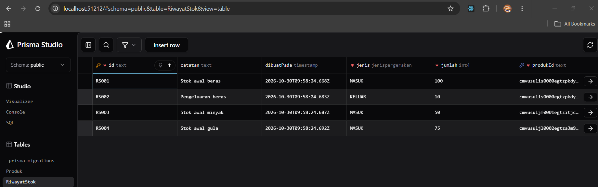

### 3.3 Prisma Client

Aplikasi Next.js menggunakan satu instance Prisma Client melalui `lib/prisma.ts`. File tersebut menggunakan `server-only`, PostgreSQL adapter (`@prisma/adapter-pg`), dan penyimpanan instance pada `globalThis` agar instance tidak dibuat berulang ketika terjadi *hot reload* selama pengembangan.

Sementara itu, `prisma/seed.ts` membuat Prisma Client dan adapter sendiri karena proses seed dijalankan melalui `tsx` di luar lingkungan Next.js. Oleh karena itu, file seed tidak mengimpor `lib/prisma.ts` yang menggunakan `server-only`.

Prisma Client dihasilkan secara eksplisit menggunakan perintah:

```powershell
npx prisma generate
```

Hasil generate disimpan pada folder `generated/prisma` sesuai konfigurasi generator di `schema.prisma`.

---

## 4. Operasi CRUD

Operasi CRUD digunakan untuk mengelola data Produk dan RiwayatStok melalui Prisma Client. Pengambilan data dilakukan pada sisi server, sedangkan operasi perubahan data menggunakan Server Actions. Setiap perubahan RiwayatStok juga menyesuaikan saldo Produk dalam transaksi database agar jumlah stok dan catatan pergerakannya tetap konsisten.

### 4.1 Tabel Implementasi CRUD

| Entitas | Operasi | Aksi atau halaman | Metode Prisma | Keterangan |
|---|---|---|---|---|
| Produk | Create | `/barang/tambah` — `simpanBarang` | `prisma.produk.create()` | Menambahkan produk baru dari formulir aplikasi. |
| Produk | Read daftar | `/barang` dan dashboard — `ambilDaftarBarang` | `prisma.produk.findMany()` | Membaca daftar produk dari PostgreSQL. |
| Produk | Read detail | `/barang/[id]` — `ambilBarang` | `prisma.produk.findUnique()` | Membaca satu produk berdasarkan ID. |
| Produk | Update | `/barang/[id]/edit` — `ubahBarang` | `prisma.produk.update()` | Memperbarui nama, kategori, stok, stok minimum, satuan, dan status ketersediaan. |
| Produk | Delete | `/barang/[id]` — `hapusBarang` | `prisma.produk.delete()` | Menghapus produk tanpa riwayat; produk yang masih direferensikan ditolak oleh `RESTRICT`. |
| RiwayatStok | Create | `/transaksi` — `simpanRiwayatStok` | `prisma.riwayatStok.create()` | Menambahkan riwayat barang masuk/keluar dan menyesuaikan stok Produk dalam transaksi. |
| RiwayatStok | Read | `/transaksi` | `prisma.riwayatStok.findMany()` | Membaca riwayat dan relasi Produk untuk menampilkan nama barang. |
| RiwayatStok | Update | `/transaksi` — `ubahRiwayatStok` | `prisma.riwayatStok.update()` | Mengubah produk, jenis, jumlah, dan catatan serta menghitung ulang dampaknya terhadap stok. |
| RiwayatStok | Delete | `/transaksi` — `hapusRiwayatStok` | `prisma.riwayatStok.delete()` | Menghapus riwayat melalui aplikasi dan mengembalikan dampak jumlahnya pada stok Produk. |

### 4.2 Validasi dan Penanganan Error Prisma

Validasi masukan RiwayatStok dilakukan di Server Action. Jumlah harus berupa bilangan bulat positif, jenis pergerakan harus `MASUK` atau `KELUAR`, dan produk yang dipilih harus tersedia di database. Transaksi barang keluar juga ditolak apabila jumlahnya melebihi stok yang tersedia.

Kode error Prisma yang ditangani atau diverifikasi:

| Kode error | Kondisi | Penanganan atau hasil |
|---|---|---|
| `P2002` | Nilai pada kolom unik, seperti nama produk, sudah digunakan. | Server Action Update menampilkan pesan bahwa nama barang sudah digunakan. |
| `P2003` | Operasi melanggar foreign key, seperti membuat riwayat dengan `produkId` tidak valid atau menghapus produk yang masih memiliki riwayat. | Operasi ditolak dan aplikasi menampilkan pesan yang sesuai pada penghapusan melalui aplikasi. |
| `P2025` | Record yang akan diperbarui atau dihapus tidak ditemukan. | Server Action Update menampilkan pesan bahwa barang tidak ditemukan atau sudah dihapus. Kode ini juga digunakan untuk memicu rollback pada pengujian transaksi. |

### 4.3 Bukti Pengujian Error P2002

Pengujian dilakukan dengan membuka formulir edit `Kopi GudangKu`, kemudian mengganti namanya menjadi `Beras Premium`, padahal nama tersebut sudah digunakan oleh produk lain.

Database menolak perubahan karena kolom `Produk.nama` memiliki constraint unik. Server Action menampilkan pesan bahwa nama barang sudah digunakan. Setelah pengujian, nama produk dikembalikan menjadi `Kopi GudangKu` dan perubahan berhasil disimpan.

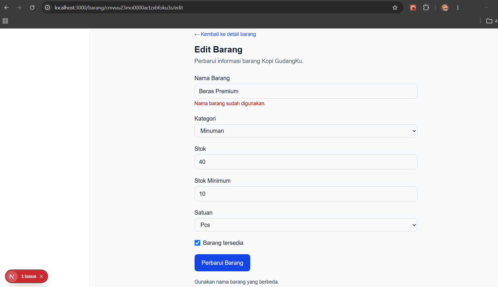

### 4.4 Bukti Pengujian Error P2025

Pengujian dilakukan dengan membuka formulir edit `Kopi GudangKu`, kemudian menghapus record produk tersebut melalui Prisma Studio ketika formulir edit masih terbuka. Formulir lama kemudian dikirim tanpa memuat ulang data.

Prisma tidak menemukan record yang akan diperbarui dan menghasilkan error `P2025`. Server Action menampilkan pesan bahwa barang tidak ditemukan atau sudah dihapus. Setelah pengujian, `Kopi GudangKu` dibuat kembali melalui formulir tambah barang.

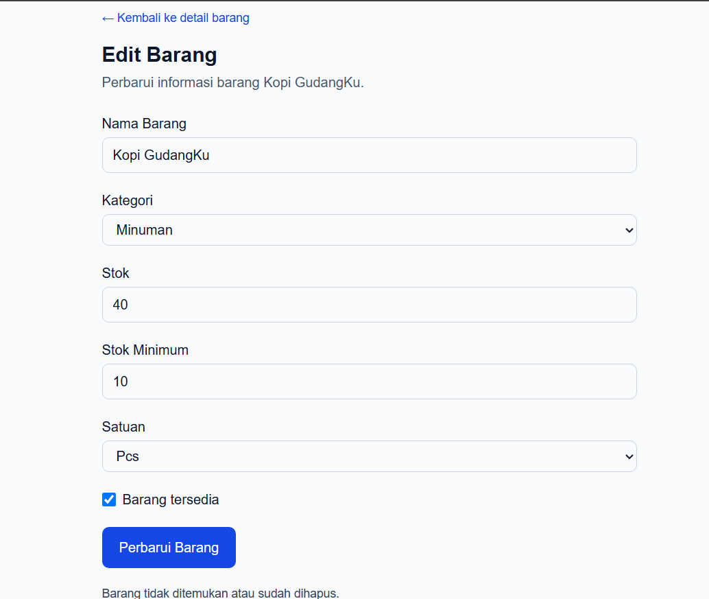

### 4.5 Bukti CRUD RiwayatStok

Pengujian CRUD RiwayatStok dilakukan pada produk Kopi GudangKu (PRD004). Pengujian Create mencatat barang masuk sebanyak 5 pcs. Pengujian Update mengubah jumlah menjadi 8 pcs dan memperbarui catatan. Pengujian Delete dilakukan melalui tombol Hapus pada halaman aplikasi, bukan dengan menghapus record langsung melalui Prisma Studio.

Setelah riwayat dihapus melalui aplikasi, saldo Kopi GudangKu kembali menjadi 40 pcs. Hal ini menunjukkan bahwa operasi Delete juga membatalkan dampak riwayat terhadap stok Produk.

**Create RiwayatStok:**

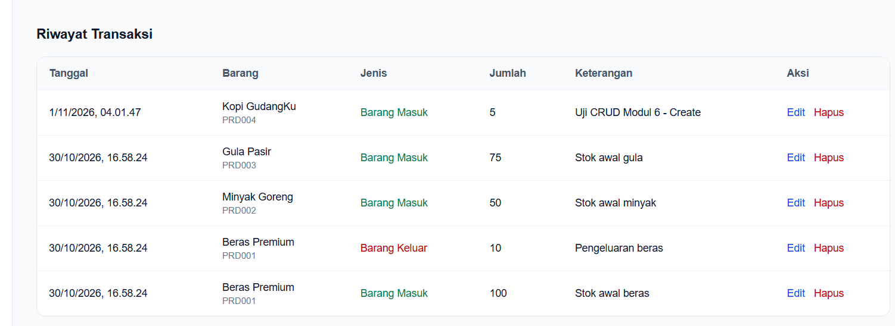

**Update RiwayatStok:**

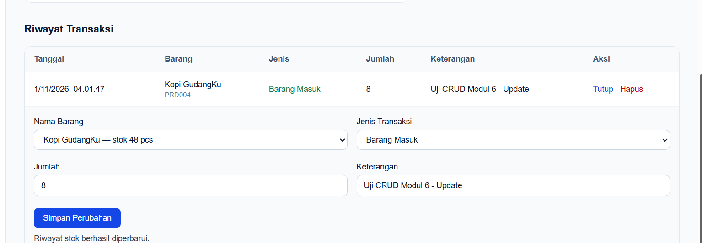

**Delete RiwayatStok:**

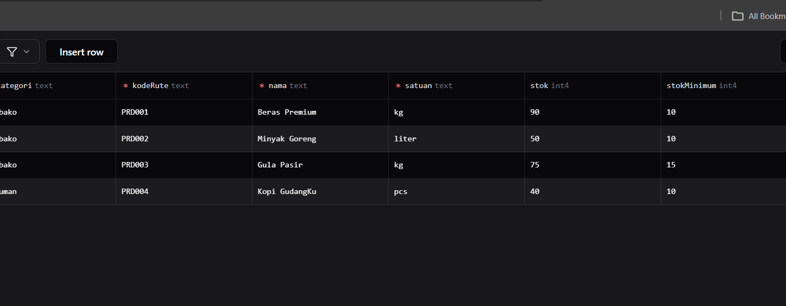

**Verifikasi stok setelah Delete:**

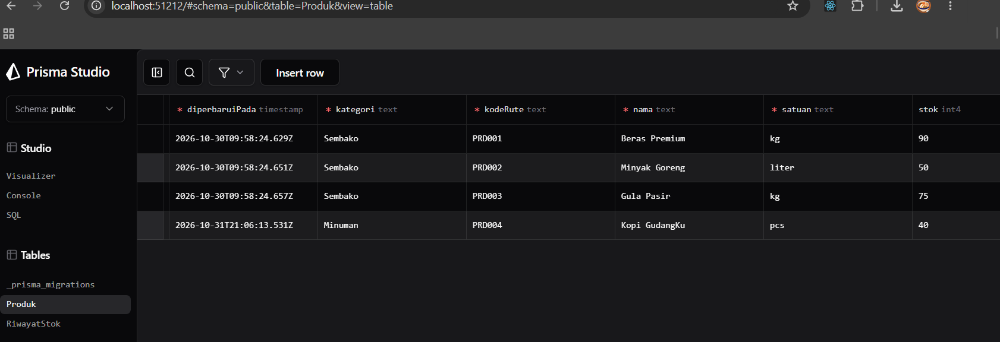

### 4.6 Bukti Delete Produk dengan RESTRICT

Penghapusan Beras Premium melalui halaman detail aplikasi ditolak karena produk masih memiliki riwayat stok. Aplikasi menampilkan pesan bahwa barang tidak dapat dihapus karena masih memiliki riwayat stok.

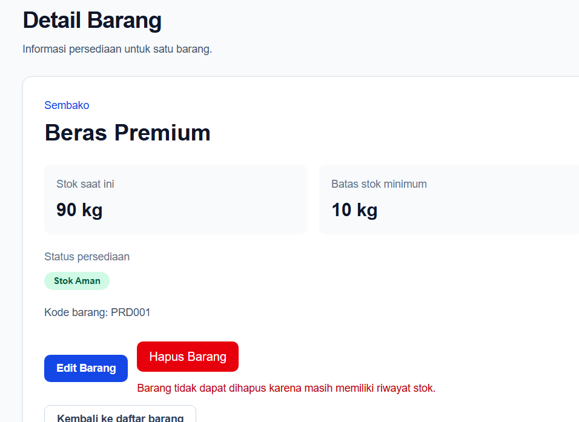

Produk Kopi GudangKu yang tidak memiliki riwayat stok kemudian berhasil dihapus melalui halaman detail aplikasi. Setelah pengujian, Kopi GudangKu dibuat kembali agar data produk uji tetap tersedia.

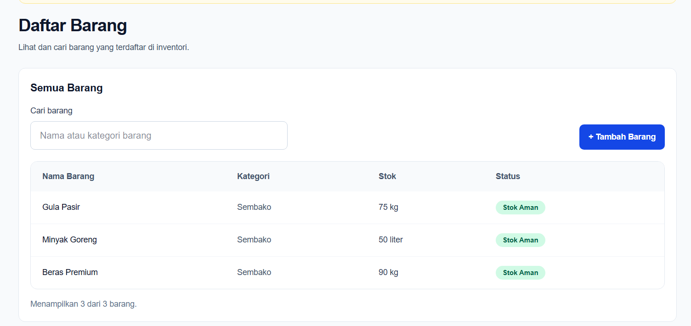

---

## 5. Transaksi dan Rollback

### 5.1 Pengujian Penghapusan dengan RESTRICT

Pengujian dilakukan dengan mencoba menghapus produk **Beras Premium** yang masih memiliki dua data riwayat stok, yaitu RS001 dan RS002.

Percobaan penghapusan melalui Prisma Studio gagal karena record produk masih direferensikan oleh tabel RiwayatStok. Pengujian menggunakan Prisma Client pada skrip `scripts/uji-transaksi.ts` menghasilkan error `P2003` (*Foreign Key Constraint*). Penghapusan melalui halaman detail aplikasi juga ditolak dan menampilkan pesan bahwa barang masih memiliki riwayat stok.

Hasil ini menunjukkan bahwa aturan `onDelete: Restrict` berjalan sesuai rancangan. Produk yang masih memiliki riwayat stok tidak dapat dihapus secara langsung.

**Bukti penghapusan ditolak oleh database:**

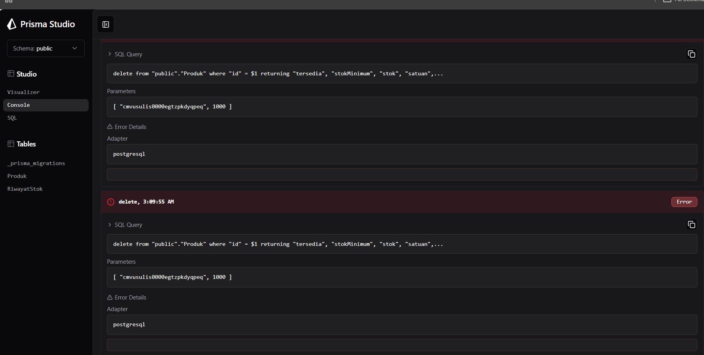

**Bukti penghapusan ditolak melalui aplikasi:**


### 5.2 Pengujian Rollback Transaksi

Pengujian dilakukan menggunakan skrip `scripts/uji-transaksi.ts` dengan Prisma `$transaction` dalam bentuk *transaction array*. Produk yang digunakan adalah Beras Premium, yang memiliki dua riwayat stok.

Transaksi menjalankan dua operasi:

1. Menghapus seluruh riwayat stok milik Beras Premium menggunakan `prisma.riwayatStok.deleteMany()`.
2. Menghapus produk menggunakan ID yang sengaja dibuat tidak valid agar operasi kedua gagal.

Operasi kedua menghasilkan error `P2025` karena produk dengan ID tersebut tidak ditemukan. Karena kedua operasi dijalankan dalam satu transaksi, perubahan pada operasi pertama dibatalkan (*rollback*).

### 5.3 Hasil Pengujian Rollback

| Pemeriksaan | Hasil aktual |
|---|---:|
| Jumlah riwayat stok sebelum transaksi | 2 |
| Hasil operasi kedua | Error `P2025` |
| Status transaksi | Dibatalkan (*rollback*) |
| Produk setelah rollback | Tetap tersedia (`true`) |
| Jumlah riwayat stok setelah rollback | 2 |

**Kesimpulan:** Jumlah riwayat stok sebelum dan sesudah transaksi tetap sama, yaitu dua record. Produk Beras Premium juga tetap tersedia. Hal ini membuktikan bahwa perubahan pada operasi pertama ikut dibatalkan ketika operasi kedua gagal.

**Bukti hasil pengujian transaksi dan rollback:**

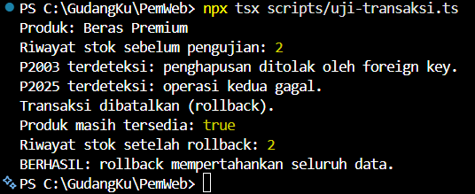

---

## 6. Skenario Uji

Skenario uji terdiri dari delapan operasi CRUD pada dua entitas dan dua skenario relasi. Pengujian dilakukan melalui antarmuka aplikasi, Prisma Client, Prisma Studio, dan skrip pengujian. Hasil aktual dicatat berdasarkan keluaran dan perubahan data yang diperiksa.

| No. | Jenis | Skenario | Langkah pengujian | Hasil yang diharapkan | Hasil aktual | Status |
|---:|---|---|---|---|---|---|
| 1 | CRUD Produk | Create Produk | Menambahkan Kopi GudangKu melalui `/barang/tambah`. | Produk baru tersimpan dan muncul pada daftar produk. | Kopi GudangKu berhasil ditambahkan dan tampil pada daftar produk. | **Lulus** |
| 2 | CRUD Produk | Read Produk | Membuka daftar produk dan halaman detail produk. | Data produk dibaca dari PostgreSQL. | Daftar dan detail produk berhasil ditampilkan menggunakan query Prisma. | **Lulus** |
| 3 | CRUD Produk | Update Produk | Mengubah data Kopi GudangKu melalui formulir edit. | Perubahan tersimpan pada database. | Perubahan berhasil disimpan; pengujian nama duplikat juga ditolak dengan penanganan `P2002`. | **Lulus** |
| 4 | CRUD Produk | Delete Produk | Menghapus Kopi GudangKu yang tidak memiliki riwayat melalui halaman detail aplikasi. | Produk terhapus dan pengguna kembali ke daftar barang. | Penghapusan berhasil; produk kemudian dibuat kembali untuk memulihkan data uji. | **Lulus** |
| 5 | CRUD RiwayatStok | Create RiwayatStok | Menambahkan transaksi barang masuk 5 pcs untuk Kopi GudangKu melalui `/transaksi`. | Riwayat tersimpan dan stok Produk bertambah 5. | Riwayat tersimpan di PostgreSQL dan stok berubah dari 40 menjadi 45. | **Lulus** |
| 6 | CRUD RiwayatStok | Read RiwayatStok | Membuka halaman `/transaksi`. | Daftar riwayat dibaca dari PostgreSQL beserta data Produk terkait. | Empat riwayat awal dan riwayat uji ditampilkan dari query Prisma. | **Lulus** |
| 7 | CRUD RiwayatStok | Update RiwayatStok | Mengubah jumlah transaksi dari 5 menjadi 8 dan memperbarui catatan. | Riwayat diperbarui dan dampak stok dihitung ulang. | Jumlah menjadi 8, catatan berubah, dan stok berubah dari 45 menjadi 48. | **Lulus** |
| 8 | CRUD RiwayatStok | Delete RiwayatStok | Menghapus riwayat uji melalui tombol Hapus pada halaman `/transaksi`. | Riwayat terhapus dan dampak stok dibatalkan. | Riwayat hilang dan stok Kopi GudangKu kembali dari 45 menjadi 40. | **Lulus** |
| 9 | Relasi | Foreign Key tidak valid | Menjalankan `scripts/uji-foreign-key.ts` dengan `produkId` yang tidak ada. | Database menolak pembuatan riwayat dan jumlah record tidak berubah. | Error `P2003` terdeteksi; jumlah riwayat tetap 4 sebelum dan sesudah pengujian. | **Lulus** |
| 10 | Relasi | Relasi 1:N dan RESTRICT | Memeriksa Beras Premium yang memiliki RS001 dan RS002, lalu mencoba menghapus produk. | Satu produk dapat memiliki banyak riwayat; penghapusan produk yang masih direferensikan ditolak. | Beras Premium memiliki dua riwayat dan penghapusan ditolak dengan `P2003`; aplikasi menampilkan pesan penolakan. | **Lulus** |

### 6.1 Persentase Kelulusan

Persentase kelulusan dihitung menggunakan jumlah skenario yang lulus dibagi jumlah seluruh skenario:

\[
\text{Persentase kelulusan} = \frac{10}{10} \times 100\% = 100\%
\]

**Hasil akhir: 10 dari 10 skenario lulus (100%).** Hasil ini memenuhi ambang minimal 90% atau sekurang-kurangnya 9 dari 10 skenario.

### 6.2 Bukti Pengujian Foreign Key Tidak Valid

Pengujian dilakukan menggunakan skrip `scripts/uji-foreign-key.ts`. Skrip mencoba membuat RiwayatStok dengan `produkId` yang tidak merujuk pada produk mana pun. Prisma menghasilkan error `P2003` dan jumlah record RiwayatStok tetap empat sebelum maupun sesudah pengujian.

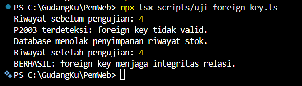

---

## 7. Kendala dan Penyelesaian

| Kendala | Penyebab atau kondisi | Penyelesaian |
|---|---|---|
| Koneksi Prisma ke PostgreSQL gagal pada tahap awal | Konfigurasi koneksi dan autentikasi database belum sesuai. | Memeriksa `DATABASE_URL`, memastikan service PostgreSQL berjalan, kemudian menguji koneksi kembali. Kredensial disimpan pada environment variable dan tidak ditulis ke repositori. |
| Konfigurasi Prisma 7 | Konfigurasi schema, datasource, dan seed menggunakan pola konfigurasi Prisma 7. | Menggunakan `prisma.config.ts` untuk menentukan lokasi schema, migrasi, seed, dan URL datasource. |
| Prisma Client belum tersedia setelah perubahan skema | Client perlu dihasilkan sesuai skema terbaru. | Menjalankan `npx prisma generate` secara eksplisit. |
| Seed tidak menggunakan Prisma Client dari aplikasi Next.js | Proses seed dijalankan melalui `tsx` di luar lingkungan Next.js, sedangkan `lib/prisma.ts` menggunakan `server-only`. | Seed membuat Prisma Client sendiri dengan PostgreSQL adapter. |
| Data Prisma Studio sempat belum tampil setelah perubahan | Tampilan tabel belum memuat ulang data terbaru. | Melakukan refresh pada Prisma Studio dan memeriksa kembali tabel yang diperlukan. |
| Pengujian Update ditolak karena belum login | Server Action memerlukan sesi pengguna yang valid. | Melakukan login melalui halaman `/masuk` sebelum menguji formulir. |
| Penghapusan riwayat langsung melalui Prisma Studio tidak menyesuaikan stok Produk | Prisma Studio menghapus record secara langsung dan tidak menjalankan Server Action aplikasi. | Stok dipulihkan ke nilai yang sesuai, kemudian pengujian Delete diulang melalui tombol Hapus pada halaman `/transaksi`. Hasilnya, riwayat terhapus dan stok kembali dari 45 menjadi 40. |
| Penghapusan produk ditolak oleh foreign key | Produk masih memiliki record terkait pada RiwayatStok. | Mempertahankan aturan `onDelete: Restrict`. Aplikasi menangani error `P2003` dan menampilkan pesan bahwa produk masih memiliki riwayat stok. |
| ESLint memberikan peringatan parameter tidak digunakan | Parameter state dan FormData tetap diperlukan oleh signature Server Action tetapi tidak digunakan pada fungsi Delete. | Menandai parameter tersebut secara eksplisit sebagai tidak digunakan menggunakan `void`, kemudian menjalankan ulang `npm run lint`. |


### 7.1 Pemeriksaan Akhir

Pemeriksaan akhir dilakukan setelah implementasi CRUD dan pengujian selesai. Hasilnya sebagai berikut:

| Pemeriksaan | Perintah | Hasil |
|---|---|---|
| Validasi skema Prisma | `npx prisma validate` | Skema valid. |
| Status migrasi | `npx prisma migrate status` | Satu migrasi terdeteksi dan database *up to date*. |
| Pemeriksaan TypeScript | `npx tsc --noEmit` | Selesai tanpa keluaran error. |
| Pemeriksaan ESLint | `npm run lint` | Selesai tanpa error dan tanpa warning setelah parameter Server Action yang tidak digunakan ditandai secara eksplisit. |

---

## 8. Catatan Pemanfaatan AI

ChatGPT digunakan sebagai alat bantu selama pengerjaan Modul 6 untuk memahami materi, merancang implementasi, meninjau kode, membantu pemecahan masalah, dan menyusun dokumentasi teknis. AI digunakan sebagai pendamping; implementasi dan hasil pengujian tetap diperiksa langsung pada proyek lokal.

| Bagian penggunaan | Bantuan AI | Cara verifikasi |
|---|---|---|
| Perancangan data | Membantu meninjau relasi Produk dan RiwayatStok, primary key, foreign key, constraint unik, serta alasan penggunaan `onDelete: Restrict`. | Memeriksa ERD, `schema.prisma`, hasil migrasi, dan struktur tabel melalui `psql`. |
| Konfigurasi Prisma 7 | Membantu memahami konfigurasi Prisma, PostgreSQL adapter, Prisma Client, migrasi, dan seed. | Menjalankan `npx prisma validate`, `npx prisma migrate status`, `npx prisma generate`, dan `npx prisma db seed`. |
| Implementasi CRUD Produk | Membantu menyusun dan meninjau pola Server Action Create, Update, dan Delete serta query Read. | Menjalankan aplikasi, mencoba formulir, memeriksa daftar dan detail produk, serta memeriksa database melalui Prisma Studio. |
| Implementasi CRUD RiwayatStok | Membantu menyusun Server Actions untuk Create, Update, dan Delete, serta query Read. | Menguji tambah, edit, dan hapus riwayat melalui `/transaksi`, lalu memeriksa perubahan saldo Produk. |
| Penanganan error | Membantu memahami penanganan `P2002`, `P2003`, dan `P2025`. | Menguji nama duplikat, ID foreign key tidak valid, record yang sudah dihapus, serta penghapusan produk yang masih memiliki riwayat stok. |
| Transaksi dan rollback | Membantu menyusun skrip pengujian `$transaction` untuk memaksa operasi kedua gagal dan memeriksa rollback. | Menjalankan `npx tsx scripts/uji-transaksi.ts` serta membandingkan jumlah riwayat stok sebelum dan sesudah transaksi. |
| Pengujian dan dokumentasi | Membantu menyusun skenario uji, menafsirkan hasil terminal, dan merapikan dokumen teknis. | Mencocokkan isi dokumen dengan kode, keluaran terminal, tabel database, dan tangkapan layar aktual. |

Perintah utama yang digunakan untuk verifikasi antara lain:

```powershell
npx prisma validate
npx prisma migrate dev --name init
npx prisma migrate status
npx prisma generate
npx prisma db seed
npx prisma studio
npx tsc --noEmit
npm run lint
npx tsx scripts/uji-transaksi.ts
npx tsx scripts/uji-foreign-key.ts
```

Perubahan kode, pelaksanaan perintah, pengambilan tangkapan layar, serta pengelolaan commit dan push repositori dilakukan langsung oleh pengembang. AI tidak melakukan commit atau push ke repositori.

---

## Daftar Bukti Screenshot

Seluruh screenshot yang dirujuk dalam dokumen ini ditempatkan pada folder `docs/praktikum/modul-06/`.

| No. | Nama file | Isi bukti |
|---:|---|---|
| 01 | `01-erd.png` | Diagram ERD Produk dan RiwayatStok. |
| 02 | `02-postgresql-produk.png` | Struktur tabel Produk dari `psql`. |
| 03 | `03-postgresql-riwayat-stok.png` | Struktur tabel RiwayatStok dari `psql`. |
| 04 | `04-seed-dua-kali.png` | Keluaran seed yang dijalankan dua kali. |
| 05 | `05-studio-produk.png` | Data Produk pada Prisma Studio. |
| 06 | `06-studio-riwayat-stok.png` | Data RiwayatStok pada Prisma Studio. |
| 07 | `07-error-p2002.png` | Penolakan nama Produk duplikat pada formulir edit. |
| 08 | `08-error-p2025.png` | Penolakan update ketika record sudah dihapus. |
| 09 | `09-restrict-delete-failed.png` | Penghapusan Produk ditolak oleh foreign key pada Prisma Studio. |
| 10 | `10-rollback-transaction.png` | Hasil pengujian transaksi dan rollback. |
| 11 | `11-riwayat-create.png` | Create RiwayatStok melalui halaman transaksi. |
| 12 | `12-riwayat-update.png` | Update RiwayatStok melalui halaman transaksi. |
| 13 | `13-riwayat-delete.png` | Delete RiwayatStok melalui halaman transaksi. |
| 14 | `14-stok-setelah-delete.png` | Stok Kopi GudangKu kembali menjadi 40 setelah Delete RiwayatStok. |
| 15 | `15-restrict-produk-aplikasi.png` | Penghapusan Beras Premium ditolak melalui aplikasi karena masih memiliki riwayat. |
| 16 | `16-delete-produk-berhasil.png` | Penghapusan Kopi GudangKu yang tidak memiliki riwayat berhasil. |
| 17 | `17-foreign-key-invalid.png` | Pengujian pembuatan RiwayatStok dengan foreign key tidak valid. |
