# Dokumen Teknis Modul 7 — Debugging dan Telaah Kode

**Nama/NIM:** Pradana Akbar Razan / 105224005
**Repositori:** [PradanaAkbarRazan/GudangKu](https://github.com/PradanaAkbarRazan/GudangKu)
**Pull Request praktikum:** [PR #7 — Modul 7](https://github.com/PradanaAkbarRazan/GudangKu/pull/7)
**Branch:** `praktikum/modul-07`

> Status saat dokumen ini disusun: perubahan kode pada PR #7 telah ditinjau dan disetujui reviewer `xvasgit`. Dokumen teknis ini perlu ditambahkan ke branch PR, lalu PR diperiksa kembali dan di-merge setelah seluruh pemeriksaan GitHub terpenuhi.

## 1. Lingkungan dan Konfigurasi Debugger

### 1.1 Lingkungan pengembangan

| Komponen | Versi / informasi |
|---|---|
| Sistem operasi | Windows 11, Version 25H2, Build 26200.9974 (64-bit) |
| Node.js | 24.21.0 |
| npm | 11.19.0 |
| Next.js (GudangKu) | 16.4.2 |
| Prisma CLI | 7.10.1 |
| Prisma Client | 7.10.1 |
| TypeScript | 5.9.3 |
| Database | PostgreSQL 18 |
| Browser | Google Chrome 157.0.8103.52 (Official Build, 64-bit) |
| Branch pekerjaan | `praktikum/modul-07` |
| Basis branch PR | `72b8fed` |
| Commit basis yang dipakai saat audit riwayat kode | `4a53f09` |

Pekerjaan Modul 7 dipisahkan ke branch `praktikum/modul-07` yang dibuat berdasarkan `origin/main`, sehingga pekerjaan dari mata kuliah atau tugas lain tidak ikut tercampur ke dalam PR praktikum ini.

### 1.2 Konfigurasi debugger

File `.vscode/launch.json` menyediakan tiga konfigurasi:

1. **Next.js: debug server-side** — menjalankan server Next.js dengan Node Inspector.
2. **Next.js: debug client-side** — membuka aplikasi melalui Chrome untuk menelusuri kode client.
3. **Next.js: debug full stack** — menghubungkan proses server Node.js dengan Chrome melalui `serverReadyAction`.

Aplikasi berada di subfolder `PemWeb`, sehingga konfigurasi server menggunakan `cwd` dan lokasi program Next.js yang mengarah ke `${workspaceFolder}/PemWeb`. Setelah masukan reviewer, properti `webRoot` juga ditambahkan pada `serverReadyAction` dengan nilai `${workspaceFolder}/PemWeb` agar pemetaan source map sisi klien mengarah ke folder aplikasi yang benar.

Konfigurasi logging Prisma pada versi akhir PR membatasi query logging ke environment development:

```ts
return new PrismaClient({
  adapter,
  log:
    process.env.NODE_ENV === "development"
      ? ["query", "warn", "error"]
      : ["warn", "error"],
});
```

Query SQL dicatat saat development untuk membantu debugging. Pada environment selain development, log query tidak diaktifkan; warning dan error tetap dicatat.

### 1.3 Bukti debugger dan penelusuran

Bukti tangkapan layar debugging disimpan di `docs/praktikum/modul-07/`.

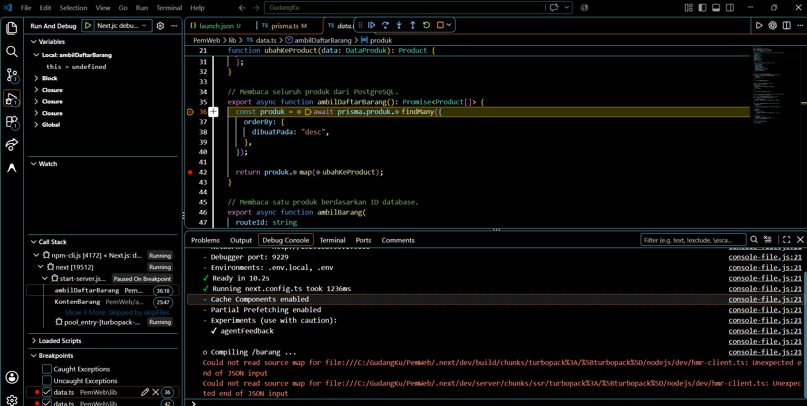

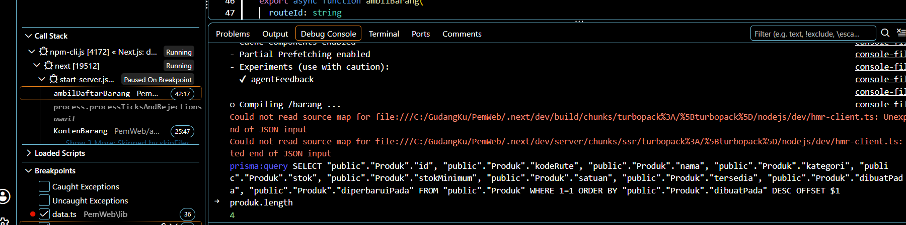

## 2. Daftar Galat dan Temuan

| No. | Issue / temuan | Gejala | Lapisan | Akar penyebab / status pada branch Modul 7 | Commit terkait |
|---|---|---|---|---|---|
| 1 | [Issue #3 — Status ketersediaan selalu true](https://github.com/PradanaAkbarRazan/GudangKu/issues/3) | Pilihan “Tidak tersedia” tidak menghasilkan status yang diharapkan | Form / validasi server | Kontrak nilai pada form perlu konsisten dengan parser boolean. Pada basis kode yang diaudit, parser sudah menggunakan `z.stringbool()`; perubahan Modul 7 menyelaraskan kontrol form agar mengirim nilai eksplisit `true` atau `false`. | `81271dc` |
| 2 | [Issue #4 — Redirect gagal setelah penghapusan](https://github.com/PradanaAkbarRazan/GudangKu/issues/4) | Barang terhapus, tetapi halaman tidak berpindah sesuai harapan | Server Action / routing | Audit terhadap basis kode branch menunjukkan `redirect()` sudah berada di luar blok `try/catch`. Implementasi ini sudah tersedia pada basis kode sebelum PR Modul 7, sehingga tidak dihitung sebagai perubahan baru dalam PR ini. | Sudah tersedia pada basis kode awal yang diaudit (`4a53f09`); tidak ada commit perbaikan baru khusus di PR Modul 7 |
| 3 | [Issue #5 — Penghapusan barang dengan riwayat stok](https://github.com/PradanaAkbarRazan/GudangKu/issues/5) | Penghapusan barang yang masih dirujuk riwayat stok perlu ditolak dengan pesan yang jelas | Database / Prisma | Audit menunjukkan penanganan khusus P2003 sudah tersedia pada basis kode sebelum PR Modul 7. Kebijakan yang dipakai adalah menolak penghapusan agar riwayat stok tetap terjaga. | Sudah tersedia pada basis kode awal yang diaudit (`4a53f09`); tidak ada commit perbaikan baru khusus di PR Modul 7 |
| 4 | [Issue #6 — Penghitung karakter catatan transaksi tidak diperbarui](https://github.com/PradanaAkbarRazan/GudangKu/issues/6) | Angka sisa karakter tidak mengikuti perubahan teks | Client Component / React state | Nilai sisa karakter sebelumnya tidak dihitung sebagai nilai turunan yang mengikuti isi input pada setiap render. Perbaikan menggunakan controlled input dan menghitung sisa karakter langsung saat render. | `e30c372`; penyempurnaan konstanta dan format pada `6639fc3` |
| 5 | Temuan production build — Sidebar | Build gagal ketika `usePathname()` digunakan di luar Suspense | Next.js / rendering | Komponen Sidebar yang memakai `usePathname()` perlu berada di dalam batas Suspense. | `21c89b2` |
| 6 | Temuan production build — halaman transaksi | Build gagal karena data runtime pada halaman transaksi tidak berada dalam batas Suspense yang sesuai | Next.js / rendering | Pengambilan data transaksi dipisahkan ke komponen `KontenTransaksi` dan komponen tersebut dibungkus dengan Suspense. | `aa31e86` |

**Catatan audit:** hasil pemeriksaan riwayat kode menunjukkan bahwa beberapa perilaku yang dilaporkan pada Issue #4 dan #5 sudah ditangani sebelum branch PR Modul 7 dibuat. Dokumen ini mencatat fakta tersebut dan tidak mengklaim bahwa keduanya merupakan perubahan kode baru pada PR ini. Temuan build pada Sidebar dan halaman transaksi dicatat terpisah karena ditemukan saat validasi production build.

## 3. Catatan Penelusuran

### 3.1 Issue #3 — Status ketersediaan selalu true

**Data awal:** produk uji memiliki status tersedia. Masalah diamati ketika pengguna memilih status “Tidak tersedia” pada formulir.

**Langkah reproduksi:**

1. Buka halaman daftar barang.
2. Pilih produk yang akan diuji.
3. Buka halaman Edit Barang.
4. Ubah status menjadi “Tidak tersedia”.
5. Simpan perubahan.
6. Periksa data yang dikirim oleh formulir dan nilai status setelah tersimpan.

**Hasil yang diharapkan:** status tersimpan sebagai `false`.

**Hasil aktual sebelum penyesuaian form:** pilihan “Tidak tersedia” tidak selalu terwakili sebagai nilai boolean false pada alur form.

**Frekuensi sebelum perbaikan:** 5 dari 5 percobaan.

**Analisis:** string `"false"` bukan nilai boolean false dengan sendirinya dalam konversi Boolean JavaScript. Karena itu, parser string boolean yang sesuai dan kontrol form yang mengirim nilai eksplisit diperlukan. Pada basis branch yang diaudit, skema sudah menggunakan `z.stringbool()`. Perubahan pada `FormEditBarang.tsx` menyelaraskan pemilihan status menjadi nilai eksplisit `true` dan `false`.

**Perubahan terkait:** commit `81271dc` (`fix(inventory): align availability form values (#3)`).

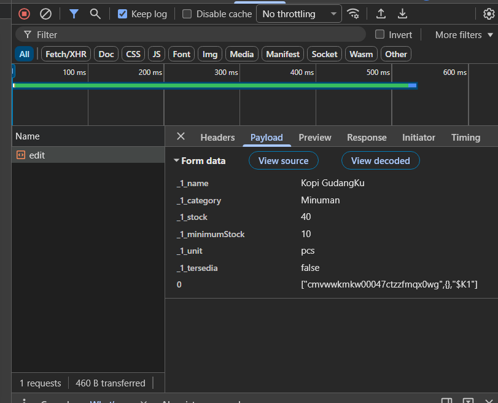

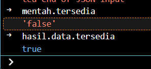

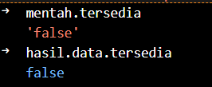

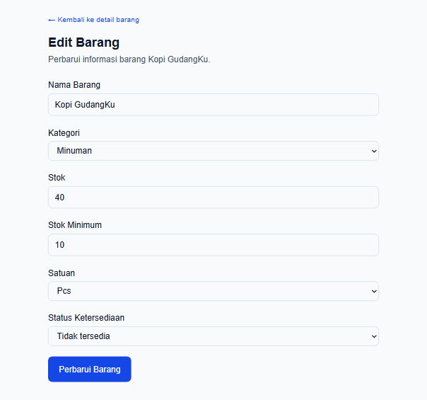

### 3.2 Issue #4 — Redirect gagal setelah penghapusan

**Data awal:** produk uji redirect tersedia dan tidak memiliki riwayat stok.

**Langkah reproduksi:**

1. Buka halaman detail produk.
2. Klik tombol Hapus Barang.
3. Konfirmasi penghapusan.
4. Amati respons aplikasi dan halaman browser.

**Hasil yang diharapkan:** produk dihapus dan pengguna diarahkan kembali ke `/barang`.

**Hasil aktual pada reproduksi awal:** produk berhasil dihapus, tetapi halaman tidak berpindah sebagaimana mestinya.

**Frekuensi sebelum perbaikan:** 1 dari 1 percobaan.

**Akar penyebab:** Next.js menggunakan mekanisme khusus untuk `redirect()`. Jika `redirect()` dipanggil di dalam blok `try`, sinyal redirect dapat tertangkap oleh `catch`.

**Hasil audit branch Modul 7:** pemanggilan `redirect()` sudah berada di luar blok `try/catch` pada basis kode yang digunakan untuk PR ini. Karena perubahan tersebut telah tersedia sebelum PR Modul 7, tidak ada commit perbaikan baru untuk Issue #4 pada PR ini.

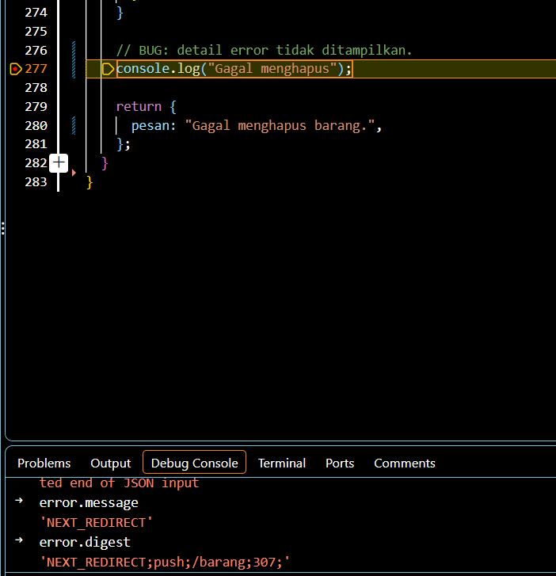

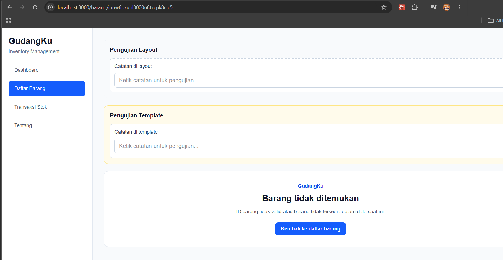

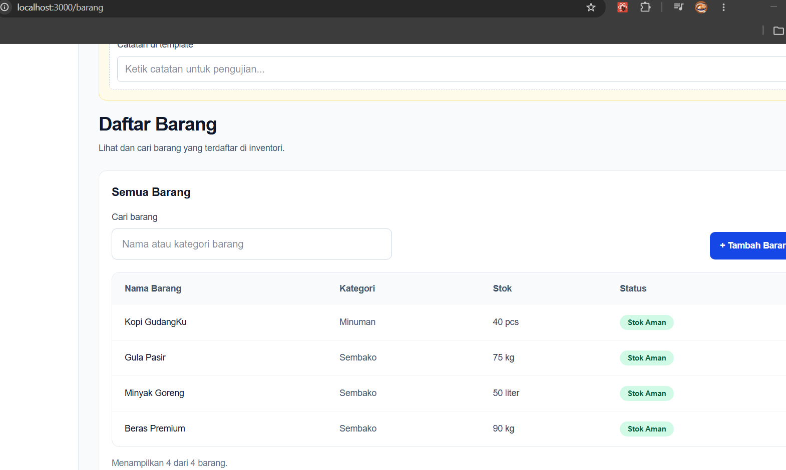

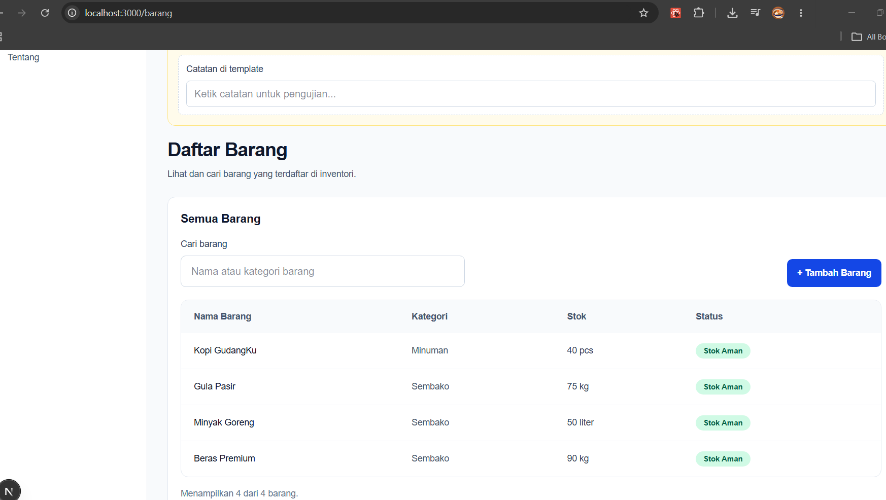

### 3.3 Issue #5 — Prisma P2003 saat menghapus barang

**Data awal:** produk uji P2003 memiliki satu atau lebih riwayat transaksi stok.

**Langkah reproduksi:**

1. Buka halaman detail produk.
2. Klik Hapus Barang.
3. Konfirmasi penghapusan.
4. Periksa pesan aplikasi dan log server.

**Hasil yang diharapkan:** penghapusan ditolak dan pengguna menerima pesan bahwa barang masih memiliki riwayat stok.

**Hasil aktual pada reproduksi awal:** database menolak penghapusan karena relasi foreign key, tetapi aplikasi belum memberikan penjelasan yang memadai.

**Frekuensi sebelum penanganan:** 1 dari 1 percobaan.

**Akar penyebab:** foreign key pada riwayat stok mencegah barang dihapus ketika masih direferensikan. Prisma menghasilkan kode error P2003.

**Keputusan teknis:** penghapusan barang yang masih memiliki riwayat stok ditolak. Riwayat transaksi dipertahankan untuk menjaga integritas dan jejak data.

**Hasil audit branch Modul 7:** penanganan P2003 yang memberikan pesan khusus sudah tersedia pada basis kode sebelum PR Modul 7. Tidak ada commit perbaikan baru khusus Issue #5 pada PR ini.

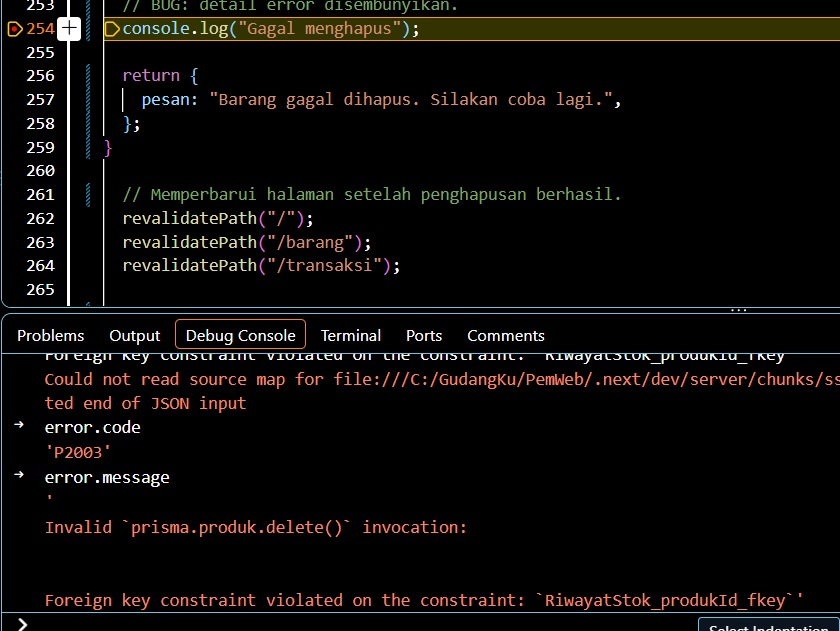

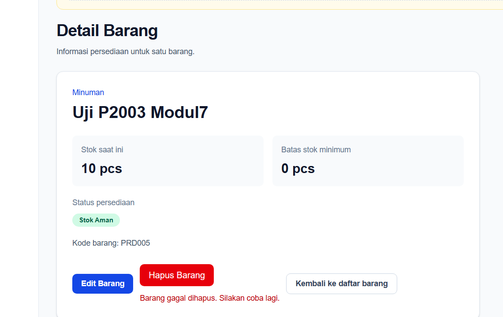

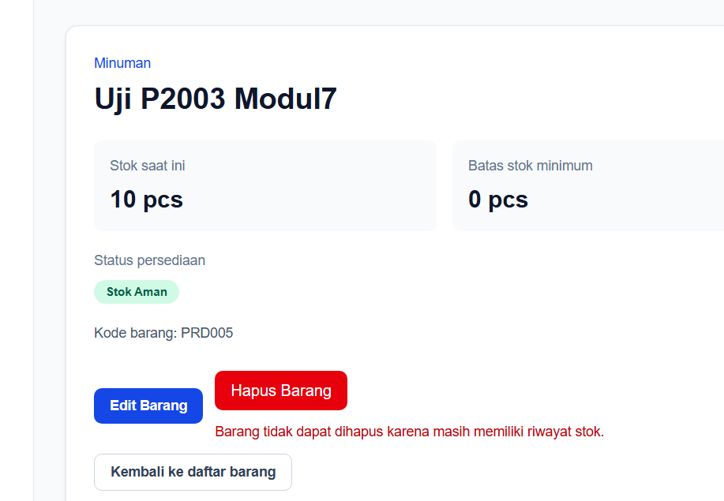

### 3.4 Issue #6 — Penghitung karakter catatan transaksi

**Data awal:** formulir Tambah Transaksi mempunyai kolom Keterangan dengan batas 500 karakter.

**Langkah reproduksi:**

1. Buka halaman `/transaksi`.
2. Buka React Developer Tools pada tab Components.
3. Pilih komponen `TransactionsClient`.
4. Ketik teks `Restock dari pemasok` pada kolom Keterangan.
5. Perhatikan nilai input dan penghitung sisa karakter.

**Hasil yang diharapkan:** penghitung berubah mengikuti panjang teks. Untuk teks `Restock dari pemasok` (20 karakter), penghitung menunjukkan 480 karakter tersisa.

**Hasil aktual sebelum perbaikan:** teks input berubah, tetapi penghitung tetap menunjukkan 500 karakter.

**Frekuensi sebelum perbaikan:** 1 dari 1 percobaan.

**Akar penyebab:** nilai sisa karakter tidak mengikuti perubahan input karena dikelola melalui mekanisme state/efek yang tidak memperbarui angka secara tepat.

**Perbaikan:** isi catatan dikelola dengan controlled input, sedangkan sisa karakter dihitung sebagai nilai turunan saat render:

```tsx
const [catatan, setCatatan] = useState("");
const sisa = 500 - catatan.length;
```

Setelah masukan reviewer, nilai batas 500 disatukan menjadi konstanta `MAX_CATATAN` dan digunakan pada `maxLength` serta perhitungan sisa karakter. Indentasi JSX pada input dan penghitung juga dirapikan.

```tsx
const MAX_CATATAN = 500;
const [catatan, setCatatan] = useState("");
const sisa = MAX_CATATAN - catatan.length;
```

**Commit terkait:** `e30c372` (perbaikan penghitung) dan `6639fc3` (tanggapan review, konstanta dan perapian JSX).

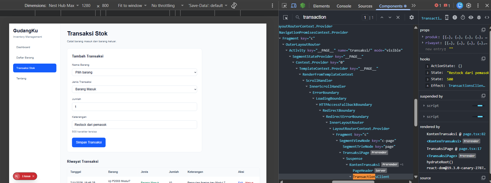

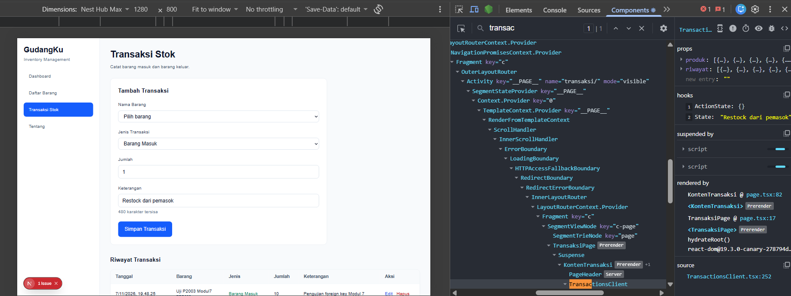

### 3.5 Temuan production build — Suspense pada Sidebar

**Gejala:** production build gagal ketika `usePathname()` pada Sidebar digunakan di luar batas Suspense yang diperlukan oleh konfigurasi Next.js.

**Langkah reproduksi:**

1. Jalankan `npm run build` dari direktori `PemWeb`.
2. Periksa keluaran build ketika Next.js melakukan proses prerendering route.
3. Telusuri komponen Sidebar yang menggunakan `usePathname()`.

**Akar penyebab:** penggunaan hook navigasi tersebut memerlukan batas Suspense pada konteks rendering yang digunakan.

**Perbaikan:** Sidebar dibungkus menggunakan `<Suspense>` pada `PemWeb/app/layout.tsx`.

**Commit:** `21c89b2` (`fix(next): add suspense boundary for sidebar`).

### 3.6 Temuan production build — Suspense pada halaman transaksi

**Gejala:** setelah perbaikan Sidebar, production build menemukan akses data runtime pada halaman `/transaksi` yang belum berada dalam batas Suspense yang sesuai.

**Langkah reproduksi:**

1. Jalankan kembali `npm run build` dari direktori `PemWeb`.
2. Periksa keluaran build pada proses rendering halaman transaksi.
3. Telusuri komponen halaman transaksi dan proses pengambilan data runtime.

**Akar penyebab:** pekerjaan pengambilan data runtime dilakukan pada struktur halaman yang memerlukan batas Suspense.

**Perbaikan:** pengambilan data dipisahkan ke komponen `KontenTransaksi`, kemudian komponen tersebut dibungkus dengan `<Suspense>` pada `PemWeb/app/transaksi/page.tsx`.

**Commit:** `aa31e86` (`fix(next): suspend runtime transaction data`).

## 4. Keputusan Teknis

### 4.1 Penggunaan `z.stringbool()` dan nilai boolean dari form

Konversi Boolean JavaScript tidak cocok untuk membaca string `"false"` secara langsung karena string yang tidak kosong dianggap truthy. `z.stringbool()` dipakai untuk membaca representasi string boolean dari form sesuai maknanya. Kontrol form juga harus mengirim nilai eksplisit `"true"` atau `"false"` agar tidak terjadi ketidaksesuaian antara input dan skema validasi.

### 4.2 Kebijakan penghapusan barang yang memiliki riwayat stok

GudangKu memilih kebijakan menolak penghapusan barang ketika masih memiliki riwayat stok. Riwayat tersebut merupakan catatan historis persediaan. Menghapusnya secara otomatis dapat menghilangkan jejak transaksi yang diperlukan untuk pemeriksaan data. Oleh karena itu, error P2003 ditangani secara khusus dan pengguna diberikan pesan yang menjelaskan alasan penghapusan ditolak.

### 4.3 Nilai turunan saat render dibandingkan `useEffect`

Sisa karakter adalah nilai yang dapat dihitung langsung dari `catatan.length`. Menghitungnya saat render lebih sederhana daripada menyimpan state tambahan dan memperbaruinya melalui `useEffect`. Dengan satu sumber nilai, angka penghitung mengikuti isi input pada setiap render.

### 4.4 Penanganan error pada Server Action dan `error.tsx`

Server Action sebaiknya menangani kondisi yang diperkirakan dan memiliki respons yang jelas, seperti P2003 atau data yang tidak ditemukan. Error yang tidak ditangani secara khusus dapat diteruskan ke error boundary pada segmen halaman. File `PemWeb/app/barang/[id]/error.tsx` merupakan Client Component yang mencatat error, menampilkan kode rujukan bila tersedia, menyediakan tombol coba lagi, dan—setelah masukan reviewer—menyediakan tautan kembali ke `/barang` sebagai jalur alternatif ketika halaman detail tidak dapat dipulihkan.

### 4.5 Batas Suspense pada Next.js

Pada konfigurasi Cache Components, bagian aplikasi yang menggunakan hook navigasi atau data runtime perlu ditempatkan dalam struktur rendering yang sesuai. Production build membantu menemukan dua lokasi yang memerlukan Suspense, yaitu Sidebar dan halaman transaksi. Perbaikan dilakukan dengan membungkus komponen terkait menggunakan Suspense tanpa menonaktifkan Cache Components.

### 4.6 Logging Prisma

Query logging membantu penelusuran SQL saat development, tetapi tidak perlu diaktifkan pada production. Konfigurasi akhir mempertahankan `query`, `warn`, dan `error` pada development, sedangkan environment lainnya hanya mencatat `warn` dan `error`.

## 5. Telaah Kode melalui Pull Request

### 5.1 Telaah PR pasangan

**Username pasangan:** `xvasgit`
**Repositori pasangan:** [xvasgit/PrivateSession](https://github.com/xvasgit/PrivateSession)
**Pull Request pasangan:** [PrivateSession — PR #7](https://github.com/xvasgit/PrivateSession/pull/7)
**Tanggal review:** 14 November 2026

Tiga inline comments yang diberikan:

| Baris / file | Kategori | Masalah | Saran perbaikan |
|---|---|---|---|
| `components/meetings/meeting-form.tsx`, baris 34 | State Management / Data Consistency | `field.value` hanya dipakai saat komponen pertama kali di-mount; jika nilai field berubah ketika komponen masih terpasang, state textarea dapat tertinggal. | Pastikan perubahan nilai awal field ditangani tanpa mengganggu input yang sedang diketik, misalnya dengan sinkronisasi yang tepat atau remount berdasarkan identitas data. |
| `components/meetings/meeting-form.tsx`, baris 76 | Error Handling / Consistency | Error P2025 dari `saveMeetingCommand` berupa Error biasa tanpa `digest`, sehingga wrapper form berpotensi mengubahnya menjadi pesan form, padahal test mengharapkan error diteruskan ke error boundary. | Selaraskan penanganan error pada wrapper dengan tujuan test dan alur error boundary. |
| `lib/prisma.ts`, baris 18 | Security / Logging | Query logging aktif pada seluruh environment development, yang mungkin terhubung ke database staging atau database bersama. | Tambahkan kontrol khusus agar query logging hanya aktif ketika debugging memang diperlukan. Suggestion Block menggunakan `PRISMA_QUERY_LOG=true`. |

Satu dari tiga komentar menggunakan **Suggestion Block**, yaitu usulan konfigurasi logging yang mengaktifkan query log hanya ketika `PRISMA_QUERY_LOG` bernilai `true` pada environment development.

**Keputusan review pertama:** `Request Changes`.
**Review ulang:** setelah pasangan menindaklanjuti masukan dan memperbarui PR, perubahan diperiksa kembali dan keputusan diubah menjadi `Approve`.

Pada pemeriksaan awal, kedua workflow `Quality checks / verify` gagal saat menjalankan `npm ci`. Log menunjukkan `package.json` dan `package-lock.json` tidak sinkron karena `@emnapi/runtime@1.11.3` dan `@emnapi/core@1.11.3` belum tercatat pada lockfile. Temuan tersebut disertakan dalam umpan balik review awal. Setelah pasangan memperbarui PR, review ulang diberikan dengan keputusan `Approve`.

### 5.2 Tanggapan terhadap review yang diterima pada PR GudangKu

**Pull Request GudangKu:** [PR #7](https://github.com/PradanaAkbarRazan/GudangKu/pull/7)
**Reviewer:** `xvasgit`

Empat masukan reviewer diterapkan:

| File | Masukan reviewer | Tanggapan / perubahan |
|---|---|---|
| `PemWeb/app/barang/[id]/error.tsx` | Tambahkan jalur alternatif kembali ke daftar inventori ketika tombol coba lagi tidak menyelesaikan error pada detail barang yang sudah tidak ada. | Menambahkan tautan `Link` dengan tujuan `/barang` di samping tombol coba lagi. |
| `PemWeb/lib/prisma.ts` | Batasi query logging agar hanya aktif pada development. | Mengubah konfigurasi log: query, warning, dan error dicatat pada development; di environment lain hanya warning dan error. |
| `.vscode/launch.json` | Tambahkan `webRoot` agar source map klien pada subfolder `PemWeb` dapat dipetakan dengan benar. | Menambahkan `"webRoot": "${workspaceFolder}/PemWeb"` pada `serverReadyAction`. |
| `PemWeb/components/TransactionsClient.tsx` | Rapikan indentasi JSX dan gunakan satu konstanta untuk batas karakter 500. | Menambahkan `MAX_CATATAN = 500`, menggunakannya pada input tambah/edit dan perhitungan penghitung, serta merapikan indentasi JSX. |

Perubahan tanggapan review digabung dalam commit `6639fc3` dengan pesan `fix(praktikum): address peer review feedback`, kemudian di-push ke branch `praktikum/modul-07`. Reviewer memberikan approval setelah perubahan tersebut diperiksa kembali.

### 5.3 Status Pull Request praktikum

- Pull Request: [GudangKu #7](https://github.com/PradanaAkbarRazan/GudangKu/pull/7)
- Branch sumber: `praktikum/modul-07`
- Branch tujuan: `main`
- Reviewer: `xvasgit`
- Status review terakhir yang dikonfirmasi: **Approved**.
- Status merge: belum dicatat sebagai merged pada saat dokumen ini disusun.

## 6. Kendala dan Penyelesaian

### 6.1 Pembuatan folder dinamis pada PowerShell

Perintah `New-Item` dengan `-LiteralPath` menghasilkan masalah parameter pada lingkungan yang digunakan. Pembuatan folder dengan nama literal yang mengandung tanda kurung siku, seperti `[id]`, dilakukan menggunakan `System.IO.Directory.CreateDirectory()`.

### 6.2 Generated Types Next.js tidak sinkron

Pemeriksaan TypeScript sebelumnya menemukan referensi route lama pada folder `.next`. Cache `.next` dibersihkan dan generated types dibuat ulang melalui production build.

### 6.3 Suspense pada Sidebar dan halaman transaksi

Production build menemukan dua masalah batas Suspense. Sidebar dibungkus dengan Suspense pada `app/layout.tsx`; pengambilan data halaman transaksi dipisahkan ke `KontenTransaksi` dan dibungkus dengan Suspense pada `app/transaksi/page.tsx`.

### 6.4 Penanganan masukan review pasangan

Review pasangan menemukan bahwa query logging perlu dibatasi, konfigurasi `webRoot` belum diarahkan ke subfolder aplikasi, error boundary memerlukan tautan alternatif ke daftar barang, dan input catatan perlu menggunakan konstanta batas karakter. Keempat masukan diterapkan dalam commit `6639fc3`.

### 6.5 Validasi akhir

Setelah empat tanggapan review diterapkan, perintah berikut dijalankan dari direktori `PemWeb`:

```powershell
npm run lint
npx tsc --noEmit
npm run build
```

Ketiga perintah berhasil tanpa error. Production build menggunakan Next.js 16.4.2, menyelesaikan kompilasi, pemeriksaan TypeScript, pengumpulan data halaman, pembuatan halaman statis (10/10), dan finalisasi optimasi.

## 7. Catatan Pemanfaatan AI

**Alat:** ChatGPT.

AI digunakan untuk membantu:

1. Memahami instruksi praktikum dan menyusun kerangka dokumen teknis.
2. Menelusuri kemungkinan akar penyebab masalah pada formulir, validasi, Server Action, Prisma, dan React.
3. Membandingkan penggunaan konversi Boolean dengan `z.stringbool()` serta perhitungan nilai turunan saat render.
4. Menyusun dan meninjau komponen error boundary.
5. Menganalisis kegagalan production build dan penggunaan Suspense pada Sidebar serta halaman transaksi.
6. Menyusun konfigurasi debugger dan logging Prisma.
7. Membantu membuat komentar peer review, mengevaluasi saran reviewer, dan merapikan dokumentasi.
8. Membantu menyiapkan perintah PowerShell dan pemeriksaan Git.

Kode dan saran dari AI diperiksa kembali oleh mahasiswa. Validasi dilakukan secara lokal menggunakan ESLint, TypeScript, dan production build. Hasil audit riwayat Git juga digunakan untuk membedakan implementasi yang sudah tersedia pada basis kode dengan perubahan baru di branch Modul 7.

AI tidak mengakses repository untuk melakukan operasi GitHub, tidak membuat commit, push, merge, atau tag. Seluruh operasi Git dan tindakan pada GitHub dilakukan sendiri oleh mahasiswa. Rincian bantuan AI juga dicatat pada `AI_LOG.md`.
