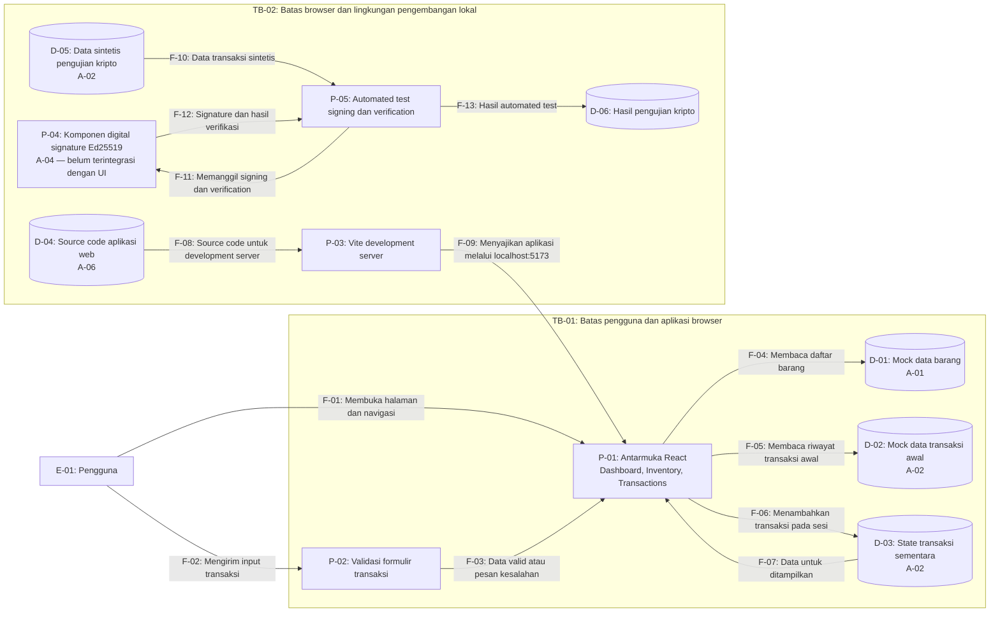

# DFD — GudangKu

## 1. Tujuan

Diagram Data Flow (DFD) ini menggambarkan komponen, penyimpanan data, dan aliran data pada GudangKu untuk mendukung threat modeling dan analisis risiko Tugas 1 Keamanan Komputasi dan Siber.

Diagram dibuat berdasarkan kondisi produk pada Milestone 1.

## 2. Kondisi Produk Saat Ini

- Aplikasi web menggunakan React, TypeScript, dan Tailwind CSS.
- Dashboard dan halaman Inventory membaca mock data barang.
- Form Transactions melakukan validasi input dan menambahkan transaksi ke state React.
- Data transaksi belum disimpan secara permanen ke database.
- Aplikasi belum memiliki backend atau autentikasi pengguna.
- Komponen digital signature Ed25519 berada di folder Kriptografi dan belum terhubung ke UI PemWeb.

## 3. Diagram Aliran Data

## 4. Identitas Elemen DFD

| ID | Elemen | Keterangan |
|---|---|---|
| E-01 | Pengguna | Pengguna yang membuka halaman dan memasukkan data transaksi |
| P-01 | Antarmuka React | Menampilkan Dashboard, daftar barang, dan halaman transaksi |
| P-02 | Validasi formulir | Memeriksa input transaksi pada sisi klien |
| P-03 | Vite development server | Menyediakan aplikasi pada lingkungan pengembangan lokal |
| P-04 | Komponen digital signature | Mengimplementasikan signing dan verification menggunakan Ed25519 |
| P-05 | Automated test | Menjalankan pengujian komponen kriptografi |
| D-01 | Mock data barang | Data barang, kategori, stok, dan stok minimum |
| D-02 | Mock data transaksi awal | Riwayat transaksi sintetis yang sudah disediakan |
| D-03 | State transaksi sementara | Menyimpan transaksi baru selama sesi aplikasi |
| D-04 | Source code aplikasi web | File kode PemWeb dalam repository |
| D-05 | Data sintetis pengujian kripto | Data transaksi yang digunakan untuk menguji digital signature |
| D-06 | Hasil pengujian kripto | Hasil validasi signature dalam automated test |

## 5. Identitas Aliran Data

| ID | Dari | Ke | Data yang Mengalir |
|---|---|---|---|
| F-01 | E-01 | P-01 | Permintaan halaman dan navigasi |
| F-02 | E-01 | P-02 | ID barang, jenis transaksi, jumlah, dan keterangan |
| F-03 | P-02 | P-01 | Data transaksi yang valid atau pesan kesalahan |
| F-04 | P-01 | D-01 | Permintaan atau pembacaan mock data barang |
| F-05 | P-01 | D-02 | Pembacaan riwayat transaksi awal |
| F-06 | P-01 | D-03 | Transaksi baru yang disimpan dalam state React |
| F-07 | D-03 | P-01 | Data riwayat transaksi untuk ditampilkan |
| F-08 | D-04 | P-03 | Source code yang digunakan development server |
| F-09 | P-03 | P-01 | HTML, JavaScript, CSS, dan resource aplikasi lokal |
| F-10 | D-05 | P-05 | Data transaksi sintetis untuk pengujian |
| F-11 | P-05 | P-04 | Pemanggilan fungsi signing dan verification |
| F-12 | P-04 | P-05 | Signature dan hasil verifikasi |
| F-13 | P-05 | D-06 | Hasil automated test |

## 6. Trust Boundary

### TB-01 — Batas Pengguna dan Aplikasi Browser

Batas ini memisahkan pengguna dari proses aplikasi yang menerima dan memproses input pada browser.

Data transaksi dimasukkan melalui formulir, sehingga input perlu divalidasi. Validasi sisi klien membantu mencegah kesalahan input, tetapi tidak dapat menjadi satu-satunya perlindungan apabila nanti sistem menerima data dari sumber lain.

### TB-02 — Batas Browser dan Lingkungan Pengembangan Lokal

Batas ini memisahkan aplikasi yang berjalan di browser dari source code dan proses development server pada komputer pengembang.

Aplikasi saat ini dijalankan melalui Vite di alamat lokal. Source code dan komponen Kripto berada dalam repository yang sama, tetapi komponen Ed25519 belum dipanggil oleh aplikasi web. Perubahan source code atau dependency dapat memengaruhi aplikasi yang dijalankan.

## 7. Aset yang Berkaitan dengan Kriptografi

| ID Aset | Aset | Status Perlindungan |
|---|---|---|
| A-02 | Riwayat transaksi | Data transaksi dalam UI belum terintegrasi dengan digital signature. Data sintetis dapat digunakan dalam pengujian Kripto secara terpisah. |
| A-04 | Komponen digital signature Ed25519 | Sudah diimplementasikan dan diuji secara terpisah. |
| A-05 | Private key dan public key | Key pair dibuat melalui modul kriptografi Node.js saat pengujian; private key tidak disimpan di repository. |

**Penanda kriptografi pada DFD:** P-04 dan F-10 sampai F-12 menunjukkan proses signing dan verification yang telah diuji pada komponen Kripto. Aliran ini terpisah dari transaksi pada P-01 dan P-02, sehingga transaksi UI belum otomatis terlindungi oleh digital signature.

## 8. Komponen yang Belum Ada

Pada Milestone 1, GudangKu belum menggunakan:

- Backend/API aplikasi.
- Database permanen.
- Autentikasi dan otorisasi pengguna.
- Penyimpanan transaksi permanen.
- Integrasi digital signature dengan transaksi pada UI.

Komponen tersebut tidak digambarkan sebagai sistem aktif karena belum diimplementasikan. Komponen dapat ditambahkan pada DFD berikutnya ketika benar-benar dibangun.